# .codegraph

A GENERATED projection of source-backed facts (Cargo manifests, Rust item declarations, `use` trees,
ruff_charon call artifacts, and the hand-curated `architecture.tsv`). **The code is the truth**; this
is a grep-friendly index, never an authority. Calls come only from existing Charon artifacts;
without one the crate says `ARTIFACT_MISSING`.

## Freshness

```
python3 .claude/tools/codegraph_index.py --check   # exit 1 lists STALE crates and differing files
python3 .claude/tools/codegraph_index.py --write   # regenerate
```

No timestamps, absolute paths or HEAD sha are recorded. A crate digest is sha256 over sorted
(relpath, git blob id) of its Cargo.toml and `src/**/*.rs`. `--check` also fails on
ANCHOR-MISSING / FILE-MISSING rows in decisions.tsv.

## Evidence legend

- `CONFIRMED` — read directly from an authoritative artifact at the cited `path:line` (a Cargo manifest
  key, a Rust declaration or `use` statement as written, a Charon COMPILER-graded resolved call).
- `POSSIBLE` — a relationship inferred, not proven: a glob import, a re-export chain not resolved,
  a `MAY_DISPATCH` / dynamic call, a textual mention.
- `UNKNOWN` — no fact source covers it (e.g. calls when no Charon artifact).
- `LAB` / `OPEN-PR` / `PROPOSED` / `GAP` — only in architecture-derived rows; copied from
  architecture.tsv, never inferred.
- `STALE` — the cited source changed since the fact was recorded (Charon file hash mismatch).

## Files

- `crates.tsv`, `freshness.tsv`, `coverage.tsv` — crate inventory, digests, what the scanner could not see.
- `dependencies.tsv` / `reverse_dependencies.tsv` — `features_enabling` = this crate's own Cargo features
  that switch the dependency on; `internal` = target is an in-scope crate.
- `symbols.tsv` — pub / pub(crate) top-level items and `pub fn`/`const` in impl blocks (`Type::method`);
  `impl` rows carry visibility `-`. `imports.tsv` — one row per use-tree leaf, cfg kept.
- `calls.tsv` — Charon rows only. `decisions.tsv` / `gaps.tsv` — validated architecture rows.
- `crates/<crate>.index.md`, `views/<symbol>.md`.

Not scanned: macro-generated items, function-local `use`, `tests/`, `examples/`, `benches/`.

## Grep recipes (NEW / DERIVED 2026-11-11)

The original ~15 navigation commands referenced in earlier discussion were not recovered; these recipes are new and derived, not historical.

<!-- recipes -->
```
rg -n '^lance-graph-contract\t' .codegraph/reverse_dependencies.tsv   # who depends on a crate
rg -n '\tClassView\t' .codegraph/symbols.tsv                          # where a symbol is defined
rg -n 'lance_graph_contract::class_view' .codegraph/imports.tsv         # who imports a path
rg -n 'feature=' .codegraph/imports.tsv .codegraph/symbols.tsv         # cfg-gated imports and items
rg -n 'ARTIFACT_MISSING' .codegraph/gaps.tsv                                # crates with no call graph
```
<!-- /recipes -->

## Crates

| crate | workspace | path |
|---|---|---|
| [bge-m3](crates/bge-m3.index.md) | excluded | crates/bge-m3 |
| [bgz-tensor](crates/bgz-tensor.index.md) | member | crates/bgz-tensor |
| [bgz17](crates/bgz17.index.md) | excluded | crates/bgz17 |
| [causal-edge](crates/causal-edge.index.md) | excluded | crates/causal-edge |
| [cg-beh-probe](crates/cg-beh-probe.index.md) | excluded | crates/cg-beh-probe |
| [cognitive-compiler](crates/cognitive-compiler.index.md) | excluded | crates/cognitive-compiler |
| [cognitive-polyfill-probe](crates/cognitive-polyfill-probe.index.md) | excluded | crates/cognitive-polyfill-probe |
| [cognitive-shader-driver](crates/cognitive-shader-driver.index.md) | member | crates/cognitive-shader-driver |
| [cognitive-stack](crates/cognitive-stack.index.md) | excluded | crates/cognitive-stack |
| [crepe-plan-probe](crates/crepe-plan-probe.index.md) | excluded | crates/crepe-plan-probe |
| [d-diamond-1-probe](crates/d-diamond-1-probe.index.md) | excluded | crates/d-diamond-1-probe |
| [deepnsm](crates/deepnsm.index.md) | excluded | crates/deepnsm |
| [deepnsm-v2](crates/deepnsm-v2.index.md) | excluded | crates/deepnsm-v2 |
| [dr-isa-stream-lab](crates/dr-isa-stream-lab.index.md) | excluded | crates/dr-isa-stream-lab |
| [dr-select-k-lab](crates/dr-select-k-lab.index.md) | excluded | crates/dr-select-k-lab |
| [dr256-ternlog-lab](crates/dr256-ternlog-lab.index.md) | member | crates/dr256-ternlog-lab |
| [drf-focus-probe](crates/drf-focus-probe.index.md) | excluded | crates/drf-focus-probe |
| [drisa-register-probe](crates/drisa-register-probe.index.md) | excluded | crates/drisa-register-probe |
| [dt64-admission-probe](crates/dt64-admission-probe.index.md) | excluded | crates/dt64-admission-probe |
| [dt64-hotplug-probe](crates/dt64-hotplug-probe.index.md) | excluded | crates/dt64-hotplug-probe |
| [dto-class-check](crates/dto-class-check.index.md) | member | tools/dto-class-check |
| [duckdb-selvec-compat](crates/duckdb-selvec-compat.index.md) | excluded | crates/duckdb-selvec-compat |
| [elixir-template](crates/elixir-template.index.md) | excluded | crates/elixir-template |
| [foundry-parity-lab](crates/foundry-parity-lab.index.md) | excluded | crates/foundry-parity-lab |
| [gkat-probe](crates/gkat-probe.index.md) | excluded | crates/gkat-probe |
| [grammar-constraints-probe](crates/grammar-constraints-probe.index.md) | excluded | crates/grammar-constraints-probe |
| [helix](crates/helix.index.md) | excluded | crates/helix |
| [highheelbgz](crates/highheelbgz.index.md) | excluded | crates/highheelbgz |
| [holo-h14d-probe](crates/holo-h14d-probe.index.md) | excluded | crates/holo-h14d-probe |
| [holo-lance-masked-io-probe](crates/holo-lance-masked-io-probe.index.md) | excluded | crates/holo-lance-masked-io-probe |
| [holograph](crates/holograph.index.md) | excluded | crates/holograph |
| [jc](crates/jc.index.md) | excluded | crates/jc |
| [jc-batch-probe](crates/jc-batch-probe.index.md) | excluded | crates/jc-batch-probe |
| [lance-graph](crates/lance-graph.index.md) | member | crates/lance-graph |
| [lance-graph-act-r](crates/lance-graph-act-r.index.md) | excluded | crates/lance-graph-act-r |
| [lance-graph-archetype](crates/lance-graph-archetype.index.md) | member | crates/lance-graph-archetype |
| [lance-graph-arm-discovery](crates/lance-graph-arm-discovery.index.md) | excluded | crates/lance-graph-arm-discovery |
| [lance-graph-benches](crates/lance-graph-benches.index.md) | member | crates/lance-graph-benches |
| [lance-graph-callcenter](crates/lance-graph-callcenter.index.md) | member | crates/lance-graph-callcenter |
| [lance-graph-catalog](crates/lance-graph-catalog.index.md) | member | crates/lance-graph-catalog |
| [lance-graph-codec-research](crates/lance-graph-codec-research.index.md) | excluded | crates/lance-graph-codec-research |
| [lance-graph-codegraph](crates/lance-graph-codegraph.index.md) | excluded | crates/lance-graph-codegraph |
| [lance-graph-cognitive](crates/lance-graph-cognitive.index.md) | excluded | crates/lance-graph-cognitive |
| [lance-graph-consumer-conformance](crates/lance-graph-consumer-conformance.index.md) | member | crates/lance-graph-consumer-conformance |
| [lance-graph-contract](crates/lance-graph-contract.index.md) | member | crates/lance-graph-contract |
| [lance-graph-cypher-quack](crates/lance-graph-cypher-quack.index.md) | member | crates/lance-graph-cypher-quack |
| [lance-graph-dir-sim](crates/lance-graph-dir-sim.index.md) | excluded | crates/lance-graph-dir-sim |
| [lance-graph-dt64](crates/lance-graph-dt64.index.md) | member | crates/lance-graph-dt64 |
| [lance-graph-dt64-lance](crates/lance-graph-dt64-lance.index.md) | excluded | crates/lance-graph-dt64-lance |
| [lance-graph-glove-parity](crates/lance-graph-glove-parity.index.md) | excluded | crates/lance-graph-glove-parity |
| [lance-graph-hydrate](crates/lance-graph-hydrate.index.md) | member | crates/lance-graph-hydrate |
| [lance-graph-lane-fold](crates/lance-graph-lane-fold.index.md) | member | crates/lance-graph-lane-fold |
| [lance-graph-mask-risc](crates/lance-graph-mask-risc.index.md) | member | crates/lance-graph-mask-risc |
| [lance-graph-metta](crates/lance-graph-metta.index.md) | excluded | crates/lance-graph-metta |
| [lance-graph-nal](crates/lance-graph-nal.index.md) | excluded | crates/lance-graph-nal |
| [lance-graph-nsl](crates/lance-graph-nsl.index.md) | excluded | crates/lance-graph-nsl |
| [lance-graph-ogar](crates/lance-graph-ogar.index.md) | excluded | crates/lance-graph-ogar |
| [lance-graph-onnx](crates/lance-graph-onnx.index.md) | member | crates/lance-graph-onnx |
| [lance-graph-ontology](crates/lance-graph-ontology.index.md) | member | crates/lance-graph-ontology |
| [lance-graph-osint](crates/lance-graph-osint.index.md) | excluded | crates/lance-graph-osint |
| [lance-graph-planner](crates/lance-graph-planner.index.md) | member | crates/lance-graph-planner |
| [lance-graph-python](crates/lance-graph-python.index.md) | excluded | crates/lance-graph-python |
| [lance-graph-quack](crates/lance-graph-quack.index.md) | member | crates/lance-graph-quack |
| [lance-graph-r2il](crates/lance-graph-r2il.index.md) | member | crates/lance-graph-r2il |
| [lance-graph-rbac](crates/lance-graph-rbac.index.md) | member | crates/lance-graph-rbac |
| [lance-graph-relalg](crates/lance-graph-relalg.index.md) | excluded | crates/lance-graph-relalg |
| [lance-graph-report](crates/lance-graph-report.index.md) | member | crates/lance-graph-report |
| [lance-graph-report-ogar](crates/lance-graph-report-ogar.index.md) | excluded | crates/lance-graph-report-ogar |
| [lance-graph-sap](crates/lance-graph-sap.index.md) | excluded | crates/lance-graph-sap |
| [lance-graph-supervisor](crates/lance-graph-supervisor.index.md) | member | crates/lance-graph-supervisor |
| [lance-graph-turbovec](crates/lance-graph-turbovec.index.md) | excluded | crates/lance-graph-turbovec |
| [lance-graph-xlog](crates/lance-graph-xlog.index.md) | member | crates/lance-graph-xlog |
| [learning](crates/learning.index.md) | excluded | crates/learning |
| [mork-pathmap-probe](crates/mork-pathmap-probe.index.md) | excluded | crates/mork-pathmap-probe |
| [neural-debug](crates/neural-debug.index.md) | member | crates/neural-debug |
| [ogar-behavior-probe](crates/ogar-behavior-probe.index.md) | excluded | crates/ogar-behavior-probe |
| [onebrc-probe](crates/onebrc-probe.index.md) | excluded | crates/onebrc-probe |
| [p64-bridge](crates/p64-bridge.index.md) | excluded | crates/p64-bridge |
| [perturbation-sim](crates/perturbation-sim.index.md) | excluded | crates/perturbation-sim |
| [pg-parity-harness](crates/pg-parity-harness.index.md) | member | crates/pg-parity-harness |
| [quasicryth-research](crates/quasicryth-research.index.md) | excluded | crates/quasicryth-research |
| [r2il-mask-abi-probe](crates/r2il-mask-abi-probe.index.md) | excluded | crates/r2il-mask-abi-probe |
| [reader-lm](crates/reader-lm.index.md) | excluded | crates/reader-lm |
| [rp-seal-t0-probe](crates/rp-seal-t0-probe.index.md) | excluded | crates/rp-seal-t0-probe |
| [sag-ra-probe](crates/sag-ra-probe.index.md) | excluded | crates/sag-ra-probe |
| [sigker](crates/sigker.index.md) | excluded | crates/sigker |
| [sigma-tier-router](crates/sigma-tier-router.index.md) | member | crates/sigma-tier-router |
| [soa64-u64-lab](crates/soa64-u64-lab.index.md) | excluded | crates/soa64-u64-lab |
| [surreal_container](crates/surreal_container.index.md) | member | crates/surreal_container |
| [symbiont](crates/symbiont.index.md) | excluded | crates/symbiont |
| [template-equivalence](crates/template-equivalence.index.md) | excluded | crates/template-equivalence |
| [template-runtime](crates/template-runtime.index.md) | excluded | crates/template-runtime |
| [thinking-engine](crates/thinking-engine.index.md) | excluded | crates/thinking-engine |
| [thought-git-probe](crates/thought-git-probe.index.md) | excluded | crates/thought-git-probe |
| [tract-harvest-probe](crates/tract-harvest-probe.index.md) | excluded | crates/tract-harvest-probe |
| [weather-poc](crates/weather-poc.index.md) | excluded | crates/weather-poc |

## Crate dependency diagram

Generated from Cargo manifests — extracted relationships only. Internal `normal` dependencies; only crates with at least one internal edge are drawn (81 of 96).

```mermaid
flowchart LR
  n0["bge-m3"]
  n1["bgz-tensor"]
  n2["bgz17"]
  n3["causal-edge"]
  n4["cg-beh-probe"]
  n5["cognitive-compiler"]
  n6["cognitive-polyfill-probe"]
  n7["cognitive-shader-driver"]
  n8["cognitive-stack"]
  n9["crepe-plan-probe"]
  n10["d-diamond-1-probe"]
  n11["deepnsm"]
  n12["deepnsm-v2"]
  n13["dr-isa-stream-lab"]
  n14["dr-select-k-lab"]
  n15["dr256-ternlog-lab"]
  n16["drf-focus-probe"]
  n17["drisa-register-probe"]
  n18["dt64-admission-probe"]
  n19["dt64-hotplug-probe"]
  n22["elixir-template"]
  n23["foundry-parity-lab"]
  n25["grammar-constraints-probe"]
  n27["highheelbgz"]
  n28["holo-h14d-probe"]
  n30["holograph"]
  n31["jc"]
  n32["jc-batch-probe"]
  n33["lance-graph"]
  n35["lance-graph-archetype"]
  n36["lance-graph-arm-discovery"]
  n37["lance-graph-benches"]
  n38["lance-graph-callcenter"]
  n39["lance-graph-catalog"]
  n41["lance-graph-codegraph"]
  n42["lance-graph-cognitive"]
  n43["lance-graph-consumer-conformance"]
  n44["lance-graph-contract"]
  n45["lance-graph-cypher-quack"]
  n46["lance-graph-dir-sim"]
  n47["lance-graph-dt64"]
  n48["lance-graph-dt64-lance"]
  n49["lance-graph-glove-parity"]
  n50["lance-graph-hydrate"]
  n51["lance-graph-lane-fold"]
  n52["lance-graph-mask-risc"]
  n53["lance-graph-metta"]
  n54["lance-graph-nal"]
  n56["lance-graph-ogar"]
  n57["lance-graph-onnx"]
  n58["lance-graph-ontology"]
  n59["lance-graph-osint"]
  n60["lance-graph-planner"]
  n61["lance-graph-python"]
  n62["lance-graph-quack"]
  n63["lance-graph-r2il"]
  n64["lance-graph-rbac"]
  n65["lance-graph-relalg"]
  n66["lance-graph-report"]
  n67["lance-graph-report-ogar"]
  n68["lance-graph-sap"]
  n69["lance-graph-supervisor"]
  n71["lance-graph-xlog"]
  n72["learning"]
  n73["mork-pathmap-probe"]
  n75["ogar-behavior-probe"]
  n76["onebrc-probe"]
  n77["p64-bridge"]
  n78["perturbation-sim"]
  n82["reader-lm"]
  n85["sigker"]
  n86["sigma-tier-router"]
  n87["soa64-u64-lab"]
  n88["surreal_container"]
  n89["symbiont"]
  n90["template-equivalence"]
  n91["template-runtime"]
  n92["thinking-engine"]
  n93["thought-git-probe"]
  n94["tract-harvest-probe"]
  n95["weather-poc"]
  n0 --> n1
  n1 --> n30
  n1 --> n44
  n4 --> n23
  n4 --> n44
  n4 --> n47
  n4 --> n63
  n6 --> n47
  n6 --> n52
  n7 --> n2
  n7 --> n3
  n7 --> n11
  n7 --> n44
  n7 --> n58
  n7 --> n60
  n7 --> n77
  n7 --> n92
  n8 --> n5
  n8 --> n22
  n8 --> n33
  n8 --> n44
  n8 --> n56
  n8 --> n90
  n8 --> n91
  n9 --> n44
  n9 --> n52
  n9 --> n65
  n9 --> n73
  n10 --> n44
  n10 --> n52
  n10 --> n62
  n11 --> n42
  n11 --> n44
  n12 --> n3
  n12 --> n36
  n12 --> n44
  n13 --> n44
  n13 --> n47
  n14 --> n52
  n15 --> n44
  n15 --> n47
  n15 --> n52
  n16 --> n60
  n17 --> n44
  n17 --> n47
  n17 --> n52
  n18 --> n44
  n18 --> n47
  n19 --> n44
  n19 --> n47
  n19 --> n56
  n23 --> n44
  n23 --> n47
  n23 --> n52
  n23 --> n65
  n25 --> n44
  n25 --> n47
  n25 --> n52
  n25 --> n62
  n27 --> n1
  n28 --> n52
  n28 --> n63
  n28 --> n65
  n31 --> n85
  n32 --> n31
  n32 --> n52
  n32 --> n65
  n33 --> n1
  n33 --> n2
  n33 --> n39
  n33 --> n42
  n33 --> n44
  n33 --> n50
  n33 --> n52
  n33 --> n60
  n33 --> n62
  n33 --> n63
  n35 --> n44
  n36 --> n44
  n37 --> n15
  n37 --> n33
  n37 --> n44
  n37 --> n45
  n37 --> n47
  n37 --> n52
  n37 --> n62
  n38 --> n44
  n38 --> n58
  n38 --> n64
  n41 --> n44
  n41 --> n47
  n41 --> n52
  n41 --> n62
  n41 --> n71
  n42 --> n30
  n42 --> n44
  n43 --> n38
  n43 --> n44
  n43 --> n56
  n43 --> n58
  n43 --> n64
  n45 --> n33
  n45 --> n52
  n45 --> n62
  n46 --> n44
  n46 --> n52
  n46 --> n62
  n47 --> n44
  n48 --> n33
  n48 --> n44
  n48 --> n47
  n48 --> n60
  n48 --> n69
  n49 --> n44
  n49 --> n56
  n49 --> n58
  n49 --> n62
  n51 --> n44
  n53 --> n52
  n53 --> n62
  n54 --> n44
  n54 --> n52
  n54 --> n63
  n56 --> n44
  n56 --> n58
  n58 --> n44
  n59 --> n2
  n59 --> n3
  n59 --> n11
  n59 --> n60
  n59 --> n77
  n60 --> n2
  n60 --> n3
  n60 --> n44
  n60 --> n77
  n61 --> n33
  n62 --> n44
  n62 --> n52
  n63 --> n44
  n63 --> n47
  n63 --> n52
  n64 --> n44
  n65 --> n44
  n65 --> n52
  n65 --> n63
  n66 --> n44
  n66 --> n47
  n66 --> n52
  n66 --> n62
  n67 --> n44
  n67 --> n66
  n68 --> n44
  n68 --> n52
  n68 --> n62
  n69 --> n38
  n69 --> n44
  n69 --> n60
  n71 --> n44
  n71 --> n47
  n71 --> n52
  n71 --> n62
  n72 --> n44
  n73 --> n52
  n75 --> n44
  n75 --> n47
  n76 --> n44
  n77 --> n2
  n77 --> n3
  n78 --> n44
  n82 --> n1
  n86 --> n3
  n86 --> n44
  n87 --> n44
  n87 --> n47
  n88 --> n44
  n89 --> n33
  n89 --> n44
  n89 --> n56
  n89 --> n78
  n92 --> n1
  n92 --> n3
  n92 --> n27
  n92 --> n31
  n92 --> n44
  n93 --> n44
  n94 --> n44
  n94 --> n57
  n95 --> n44
  classDef shipped fill:#d8f0d8,stroke:#2e7d32,color:#111
  classDef lab fill:#fff3cd,stroke:#a67c00,color:#111
  classDef open fill:#d6e6fa,stroke:#1565c0,color:#111
  classDef gap fill:#fadadd,stroke:#c62828,stroke-dasharray:5 3,color:#111
  class n1,n7,n15,n33,n35,n37,n38,n39,n43,n44,n45,n47,n50,n51,n52,n57,n58,n60,n62,n63,n64,n66,n69,n71,n86,n88 shipped
  class n0,n2,n3,n4,n5,n6,n8,n9,n10,n11,n12,n13,n14,n16,n17,n18,n19,n22,n23,n25,n27,n28,n30,n31,n32,n36,n41,n42,n46,n48,n49,n53,n54,n56,n59,n61,n65,n67,n68,n72,n73,n75,n76,n77,n78,n82,n85,n87,n89,n90,n91,n92,n93,n94,n95 lab
```


