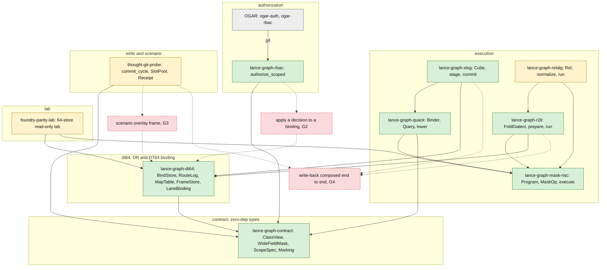

# 01 — Stack overview

Status: describes what is in this checkout. Nothing here claims Foundry parity or a graphical low-code builder. Neither exists.

The stack is a set of layers. Each layer depends on the ones below it. Values stay in source-owned planes. Layers above the contract pass addresses, masks and witnesses.

Legend: green = in code on main, yellow = lab or probe crate (excluded from the root workspace), grey = another repository, red dashed = gap (not built).

## 1.1 Layers

An arrow from A to B means "A depends on B" in a `Cargo.toml` (see [02](02-crate-dependencies.md)). Dashed red boxes are work that no code does yet.

Reading notes:

- The contract has no runtime dependencies. Every other layer builds on it.
- DT64 is the join. It ties a class, a route, a frame and a lane together and holds addresses only.
- The execution crates evaluate masks. `lance-graph-mask-risc` is the one bulk evaluator. Quack and r2il build programs for it. Quack's module doc says it may build a `Program` and must never evaluate one.
- Authorization is split. `lance-graph-rbac` has the generic kernel. OGAR supplies the login and the grant data, and calls that kernel.
- `thought-git-probe` is a probe. Its own doc says the full thought git API is a proposal and that it has no production land, rebase or persistence pipeline.
- `foundry-parity-lab` is read-only. Its doc says it has no write-back, no actions and no Foundry comparator.

Gaps in the diagram:

- **G2.** A `ScopedDecision` exists. Nothing applies it to a DT64 binding. See [04](04-read-path.md).
- **G3.** `SlotPool::branch` and `Cube::stage_closure` exist. A scenario overlay frame does not.
- **G4.** r2il can run an admitted method's effects through its fold dialect and returns a receipt. xlog has `stage` and `commit` for edges. thought-git has `commit_cycle`. No crate read here depends on more than one of the three. They are not composed into one write-back.

Sources:

- `crates/lance-graph-contract/Cargo.toml:10-17` (no runtime dependencies)
- `crates/lance-graph-dt64/src/lib.rs:1-30` (what DT64 binds and what it does not hold)
- `crates/lance-graph-mask-risc/src/lib.rs:1-20` (executor, oracle, tiled execution)
- `crates/lance-graph-quack/src/lib.rs:1-25` (operators lower to a `Program`; never evaluates)
- `crates/lance-graph-r2il/src/lib.rs:1-14` (fold reading of R2IL over mask-risc)
- `crates/lance-graph-xlog/src/lib.rs:1-20` (admitted chain query over Quack and mask-risc)
- `crates/lance-graph-relalg/src/lib.rs:1-27` (what it holds)
- `crates/lance-graph-rbac/src/authorize.rs:168-250` (`ScopedDecision`, `authorize_scoped`)
- `OGAR/crates/ogar-rbac/src/lib.rs:120-162` (`OgarRbac::authorize_user`)
- `crates/thought-git-probe/src/lib.rs:1-8` (probe status)
- `crates/foundry-parity-lab/src/lib.rs:1-26` (lab scope: read-only)
- `crates/lance-graph-xlog/src/cube.rs:856-945` (`stage`, `stage_closure`, `commit`)
- `crates/thought-git-probe/src/slots.rs:103-125` (`SlotPool::branch`)
- `crates/thought-git-probe/src/receipt.rs:153` (`commit_cycle`)
- `crates/lance-graph-r2il/src/binding.rs:1-20,321,377` (admitted effects, `prepare`, `run`)
- Cargo edges: see the sources of [02](02-crate-dependencies.md).

## 1.2 What each layer holds

| layer | crates | what it holds | what it does not do |
|---|---|---|---|
| contract | `lance-graph-contract` | Shared types: `ClassView`, `WideFieldMask`, `ScopeSpec`, `Marking`, set algebra | Run anything. It has no runtime dependencies |
| dt64 | `lance-graph-dt64` | Class schemas, method bindings (ON x WHEN x DO), the DR route log, the map table, frames, lane bindings | Hold values, evaluate, persist, or decide who may read |
| execution | `lance-graph-mask-risc`, `-quack`, `-r2il`, `-xlog`, `-relalg` | A flat program form, a name-to-number binder, an R2IL fold dialect, an admitted chain query, a relational rewrite | Loop over rows in the front ends. `mask-risc` is the only bulk engine |
| authorization | `lance-graph-rbac`, OGAR `ogar-auth` and `ogar-rbac` | Login to canonical user, grants by class, row scope, field mask | Reach the read path. G2 is open |
| write and scenario | `thought-git-probe` | Rubicon outcomes, a version-store stand-in, commit witnesses, receipts, a slot pool, squash gates | Run in production. It is a probe |
| lab | `foundry-parity-lab` | A 64-store fixture with an independent oracle, three arms (object, mask, INT8 cost) | Write, act, or compare against Foundry |

Sources:

- `crates/lance-graph-contract/src/class_view.rs:1057-1061` (`ClassView`)
- `crates/lance-graph-contract/src/rbac.rs:113-132` (`ScopeSpec`)
- `crates/lance-graph-dt64/src/lib.rs:24-30` (stored and not stored)
- `crates/lance-graph-quack/src/lib.rs:12-24` (the shapes it leaves out)
- `crates/lance-graph-r2il/src/lib.rs:1-14`
- `crates/lance-graph-xlog/src/lib.rs:1-26`
- `crates/lance-graph-relalg/src/lib.rs:1-27`
- `crates/thought-git-probe/src/receipt.rs:60-130` (`VersionStore`, `CommitWitness`, `CommitError`)
- `crates/thought-git-probe/src/fixtures.rs:28-40` (`Outcome`)
- `crates/thought-git-probe/src/squash.rs:96-100,290-300` (`squash_gate`, `protected_squash`)
- `crates/foundry-parity-lab/src/lib.rs:1-26`

## 1.3 Two limits worth knowing

- **No production issuer for execution permission.** `ExecPermit` in r2il is documented as a lab permission, not a production authorization. Who issues it is not decided. `BindStore::admit` succeeding is never a substitute for it.
- **Several records, no join drawn.** r2il returns a `Receipt` for a run. thought-git has its own `Receipt` and a `CommitWitness`. This overview draws no code that ties them to each other or to an authorization decision.

Sources:

- `crates/lance-graph-r2il/src/binding.rs:123-130` (`ExecPermit`)
- `crates/thought-git-probe/src/receipt.rs:80-100,366-380` (`CommitWitness`, `Receipt`)
- `crates/lance-graph-r2il/src/binding.rs:1-20,221-235` (r2il runs admitted effects; its `Receipt`)
