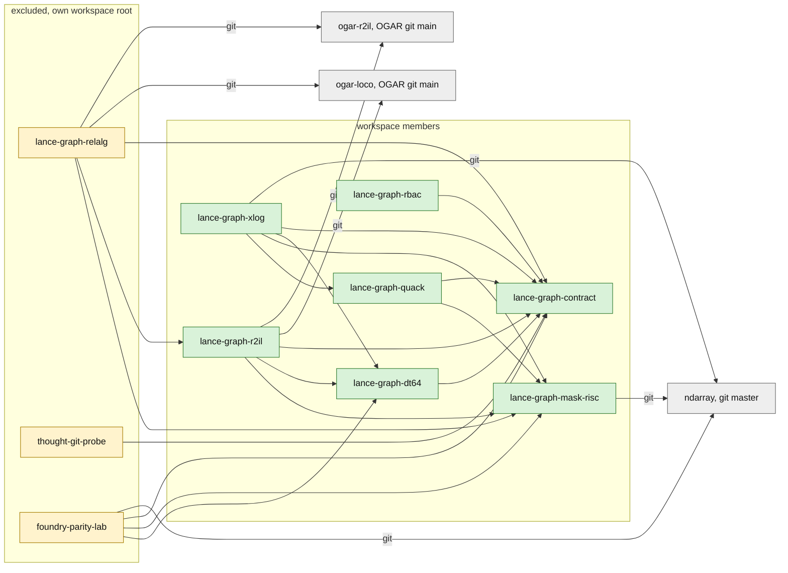
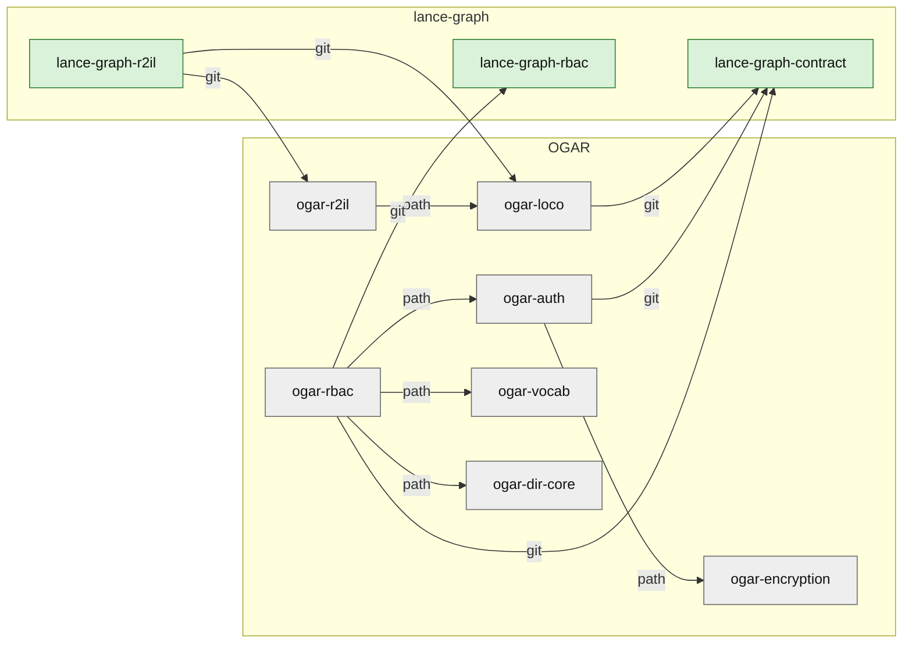

# 02 — Crate dependencies

Status: every edge below was read from a `Cargo.toml`. Dev-only edges are listed in the table and left off the diagrams.

Legend: green = workspace member of the root `Cargo.toml`. Yellow = excluded from the root workspace (the crate is its own workspace root, or is a lab crate). Grey = another repository.

## 2.1 Edges inside lance-graph

Solid edges are path dependencies. Edges marked `git` use a git coordinate.

Reading notes:

- `lance-graph-contract` has an empty `[dependencies]` table. It has one build-dependency, `serde_yaml`, used only by `build.rs`.
- `lance-graph-dt64` and `lance-graph-rbac` depend on the contract and nothing else.
- `lance-graph-mask-risc`, `lance-graph-xlog` and `foundry-parity-lab` name ndarray directly. All three use the same git coordinate. The root `[patch]` points that coordinate at the sibling checkout, so the graph holds one ndarray package.
- `lance-graph-r2il` is a workspace member and still depends on two OGAR crates by git. `lance-graph-relalg` does the same and is excluded.
- `thought-git-probe` depends on the contract only.
- In this checkout `foundry-parity-lab` does not depend on `lance-graph-relalg`.

Sources:

- `Cargo.toml:6-37` (workspace members: contract line 7, mask-risc 8, quack 9, r2il 15, xlog 21, dt64 24, rbac 35)
- `Cargo.toml:133` (`lance-graph-relalg` in `exclude`)
- `Cargo.toml:221` (`thought-git-probe` in `exclude`)
- `Cargo.toml:240` (`foundry-parity-lab` in `exclude`)
- `Cargo.toml:500-515` (root `[patch]` for the contract and ndarray)
- `crates/lance-graph-contract/Cargo.toml:10-24` (empty dependencies, build-dependencies)
- `crates/lance-graph-dt64/Cargo.toml:8-10`
- `crates/lance-graph-mask-risc/Cargo.toml:19-20`
- `crates/lance-graph-quack/Cargo.toml:12-18`
- `crates/lance-graph-r2il/Cargo.toml:17-30`
- `crates/lance-graph-xlog/Cargo.toml:8-17`
- `crates/lance-graph-rbac/Cargo.toml:7-8`
- `crates/lance-graph-relalg/Cargo.toml:11-28`
- `crates/thought-git-probe/Cargo.toml:10-13`
- `crates/foundry-parity-lab/Cargo.toml:18-27`

## 2.2 Edges that cross into OGAR and back

lance-graph depends on OGAR through the r2il crates. OGAR depends on lance-graph through the contract and the rbac crate. Both directions use a git coordinate.

Reading notes:

- The root `[patch]` maps the git coordinate of `lance-graph-contract` to the workspace member. That keeps one contract package in the graph when OGAR crates pull it by git.
- There is no such patch for `lance-graph-rbac`. `ogar-rbac` fetches it from git `main`.
- `ogar-r2il` also lists `lance-graph-contract` by git, as a dev-dependency. It is not drawn.

Sources:

- `crates/lance-graph-r2il/Cargo.toml:25-26` (`ogar-loco`, `ogar-r2il` by git)
- `Cargo.toml:500-504` (`[patch."https://github.com/AdaWorldAPI/lance-graph"]`)
- `OGAR/crates/ogar-loco/Cargo.toml:26` (contract by git)
- `OGAR/crates/ogar-r2il/Cargo.toml:11-19` (`ogar-loco` by path; contract by git under `[dev-dependencies]`)
- `OGAR/crates/ogar-auth/Cargo.toml:13,20` (`ogar-encryption` by path, contract by git)
- `OGAR/crates/ogar-rbac/Cargo.toml:14,19,24,29,33` (`ogar-auth`, `ogar-vocab`, contract, `lance-graph-rbac`, `ogar-dir-core`)

## 2.3 Dependency table

"Dev" lists dev-dependencies, which are left off the diagrams.

| crate | in root workspace | direct dependencies | dev-dependencies |
|---|---|---|---|
| lance-graph-contract | member | none (runtime) | serde_yaml, serde, criterion (and `serde_yaml` as a build-dependency) |
| lance-graph-dt64 | member | contract | none |
| lance-graph-mask-risc | member | ndarray (git master) | causal-edge, contract |
| lance-graph-quack | member | mask-risc, contract | lance-graph-arm-discovery, causal-edge, deepnsm-v2 |
| lance-graph-r2il | member | mask-risc, dt64, contract, ogar-loco (git), ogar-r2il (git) | quack |
| lance-graph-xlog | member | quack, mask-risc, dt64, contract, ndarray (git master) | lance-graph-onnx |
| lance-graph-rbac | member | contract | none |
| lance-graph-relalg | excluded, own `[workspace]` | mask-risc, r2il, contract, ogar-loco (git), ogar-r2il (git) | none |
| thought-git-probe | excluded, own `[workspace]` | contract | none |
| foundry-parity-lab | excluded, own `[workspace]` | dt64, mask-risc, contract, ndarray (git master) | none |
| ogar-auth | OGAR | ogar-encryption, contract (git), crypto crates | not read |
| ogar-rbac | OGAR | ogar-auth, ogar-vocab, ogar-dir-core, contract (git), lance-graph-rbac (git) | not read |

How to build the excluded crates:

- `relalg`: `cargo test --manifest-path crates/lance-graph-relalg/Cargo.toml`.
- `thought-git-probe`: run from its own directory.
- `foundry-parity-lab`: `cargo test --release --manifest-path crates/foundry-parity-lab/Cargo.toml`.

Sources:

- `crates/lance-graph-quack/Cargo.toml:20-30` (dev-dependencies)
- `crates/lance-graph-r2il/Cargo.toml:32-36` (dev: quack)
- `crates/lance-graph-mask-risc/Cargo.toml:32-37` (dev-dependencies)
- `crates/lance-graph-xlog/Cargo.toml:19-21` (dev: onnx)
- `crates/lance-graph-contract/Cargo.toml:26-32` (dev-dependencies)
- `crates/lance-graph-relalg/Cargo.toml:8-11` (own workspace root)
- `crates/thought-git-probe/Cargo.toml:9-10` (own workspace root, run from its directory)
- `crates/foundry-parity-lab/Cargo.toml:6-7,18` (run commands, own workspace root)
- `OGAR/crates/ogar-auth/Cargo.toml:9-45` (dependencies)
- `OGAR/crates/ogar-rbac/Cargo.toml:9-33` (dependencies)
