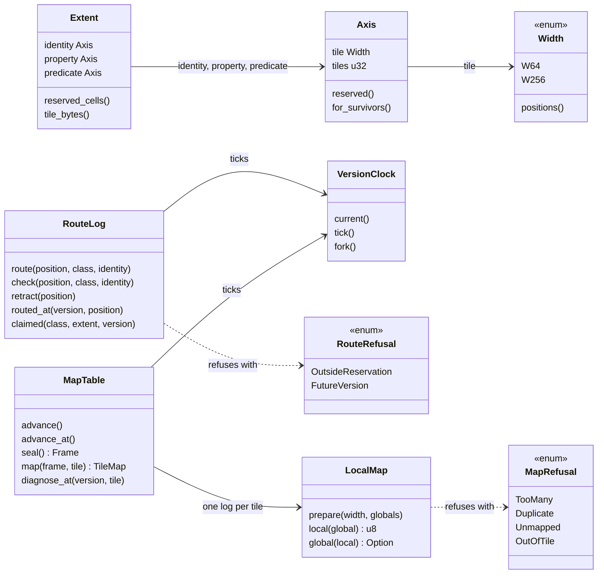
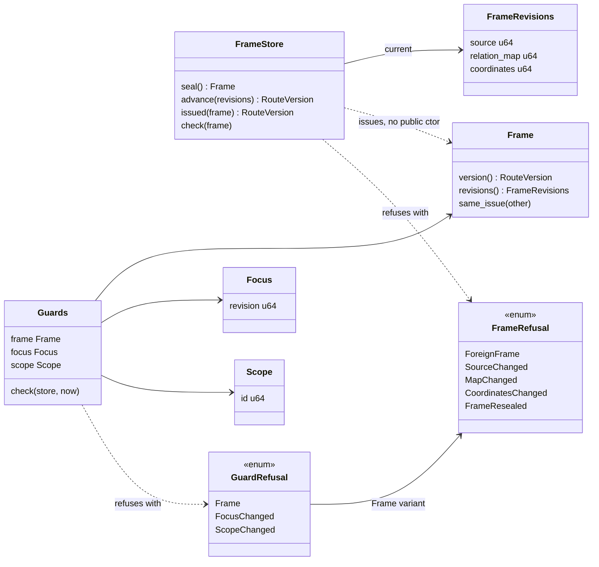
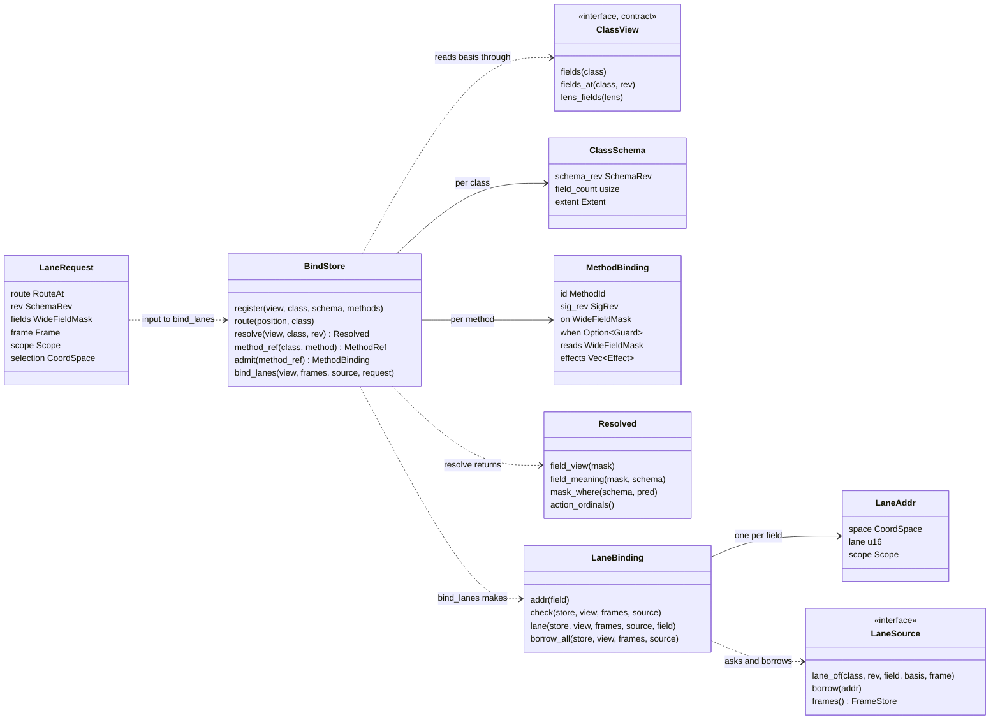
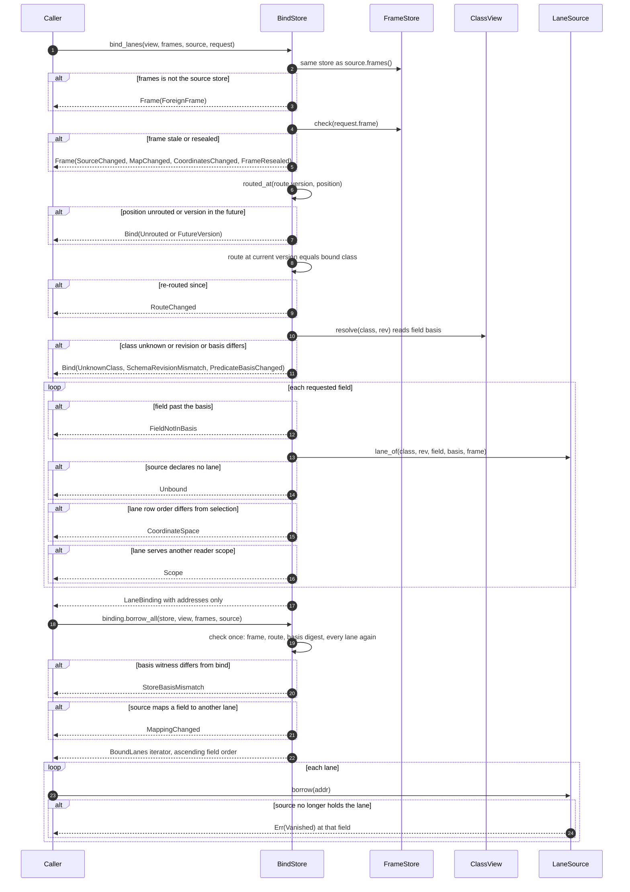

# 03 — DR / DT64 binding

Status: in code on main (crate `lance-graph-dt64`, a workspace member).

DT64 is the store that joins four things without copying any value:

- a class (`ClassId`, read through a `ClassView`),
- a route (which class a DR position points at, and at which version),
- a frame (a sealed reference to the source revisions), and
- a lane (a source-owned plane of values).

The crate holds addresses and witnesses. It holds no business value, no evaluator and no persistence path.

Legend: green = in code on main, red dashed = gap (not built).

## 3.1 DR: reservations, route log, map table

DR reserves space per class and records where each DR position routes. Both the route log and the map table tick one shared version clock.

Reading notes:

- `Width` is DR64 (`W64`) or DR256 (`W256`). A DR64 tile has 64 positions, a DR256 tile has 256.
- A class reserves an `Extent`: one `Axis` each for identity, property and predicate (methods). A reservation costs nothing. Only identity tiles a route touches count as claimed.
- `RouteLog` is append-only. Only routing is versioned; what a classid means is not.
- `MapTable` changes only by appending. An old frame replays the layout in force when it was sealed.
- `MapTable::diagnose_at` takes a bare version number and returns a read-only diagnostic, not an executable map. Execution goes through `MapTable::map` with a frame.

Sources:

- `crates/lance-graph-dt64/src/dr.rs:32-45` (`Width`)
- `crates/lance-graph-dt64/src/dr.rs:47-95` (`Axis`, `for_survivors`)
- `crates/lance-graph-dt64/src/dr.rs:97-140` (`Extent`)
- `crates/lance-graph-dt64/src/dr.rs:165-186` (`VersionClock`)
- `crates/lance-graph-dt64/src/dr.rs:190-208` (`RouteRefusal`)
- `crates/lance-graph-dt64/src/dr.rs:208-336` (`RouteLog`)
- `crates/lance-graph-dt64/src/dr.rs:555-566` (`MapRefusal`)
- `crates/lance-graph-dt64/src/dr.rs:568-660` (`LocalMap`)
- `crates/lance-graph-dt64/src/dr.rs:860-1100` (`MapTable`, `map`, `diagnose_at`)

## 3.2 Frames and guards

A frame is a seal over three revisions. Only a `FrameStore` can issue one. A frame compares by the identity of its issue, never by its numbers.

Reading notes:

- `Frame` has no public constructor. A caller cannot build one from numbers.
- `FrameStore::check` accepts only the store's current seal. A frame from another store is `ForeignFrame` even at equal numbers. A stale frame names the first revision that moved, or `FrameResealed` if none did.
- `Focus` is motion, not reference. A new focus over the same frame is not a new frame.
- `Scope` here is an opaque `u64` id. The source says which scope each lane serves. DT64 compares ids. It does not decide who may read.

Sources:

- `crates/lance-graph-dt64/src/dr.rs:355-365` (`FrameRevisions`)
- `crates/lance-graph-dt64/src/dr.rs:365-378` (`FrameRefusal`)
- `crates/lance-graph-dt64/src/dr.rs:379-484` (`FrameStore`)
- `crates/lance-graph-dt64/src/dr.rs:484-511` (`Frame`)
- `crates/lance-graph-dt64/src/dr.rs:513-555` (`Focus`, `Scope`, `Guards`, `GuardRefusal`)

## 3.3 ClassView, BindStore, lanes

`BindStore` binds a class to its methods. `ClassView` (a contract trait) supplies the field basis. `LaneSource` is the socket a source owner implements.

Reading notes:

- A `MethodBinding` is ON x WHEN x DO. `on` is the field mask that triggers it, `when` is an optional guard, `effects` is the ordered DO list.
- `BindStore::method_ref` issues a `MethodRef` stamped with the store identity. `BindStore::admit` checks that reference against the binding. It refuses with `SignatureRevisionMismatch`, `GuardDropped`, `GuardAdded`, `GuardMismatch`, `BindingMismatch` or `ForeignStore`.
- `Resolved` is an answer, not a witness. Its accessors give the field view, the meaning of each field joined by predicate to a `PropertySpec` (including its `marking`), a mask chosen by meaning, and the method ordinals.
- `PropertySpec.marking` is one of `Public`, `Internal`, `Pii`, `Financial`, `Restricted`. A field with no spec is never selected by `mask_where`.
- `LaneBinding` holds addresses only. It never holds a value.

Sources:

- `crates/lance-graph-contract/src/class_view.rs:1057-1120` (`ClassView`)
- `crates/lance-graph-dt64/src/lib.rs:213-251` (`MethodBinding`)
- `crates/lance-graph-dt64/src/lib.rs:253-262` (`ClassSchema`)
- `crates/lance-graph-dt64/src/lib.rs:352-366` (`MethodRef`)
- `crates/lance-graph-dt64/src/lib.rs:640-770` (`Resolved`, `field_view`, `field_meaning`, `mask_where`, `action_ordinals`)
- `crates/lance-graph-dt64/src/lib.rs:772-795` (`BindStore`)
- `crates/lance-graph-dt64/src/lib.rs:1136-1160` (`method_ref`)
- `crates/lance-graph-dt64/src/lib.rs:1180-1215` (`admit`)
- `crates/lance-graph-contract/src/property.rs:769-783` (`Marking`)
- `crates/lance-graph-dt64/src/lane.rs:26-142` (`CoordSpace`, `LaneAddr`, `LaneSource`, `LaneRequest`, `LaneRefusal`)
- `crates/lance-graph-dt64/src/lane.rs:151-165` (`LaneBinding`)
- `crates/lance-graph-dt64/src/lane.rs:264-396` (`LaneBinding` methods)

## 3.4 Bind then borrow

`bind_lanes` is cold and runs once per binding. `borrow_all` re-checks the binding once and then hands out every lane. Each `alt` branch below is a named refusal in the code.

Reading notes:

- Every refusal fires before any lane is borrowed. `borrow_all` runs the one check first, so N lanes cost N source lookups and not N squared.
- `LaneBinding::lane(field)` re-runs the whole check on each call and returns `NotBound` for a field outside the binding.
- `check` does not hash the basis again. It compares a `u128` witness and the revision and field count. A same-count reorder of the view after bind is caught only if the source maps lanes by predicate. The doc says to re-bind after any basis change.
- `Vanished` is yielded per lane and the iterator carries on.
- The returned lanes are as current as the check. No lock is held on the source.

Sources:

- `crates/lance-graph-dt64/src/lane.rs:104-141` (`LaneRefusal`)
- `crates/lance-graph-dt64/src/lane.rs:171-217` (`bind_lanes`)
- `crates/lance-graph-dt64/src/lane.rs:220-263` (`source_owns`, `current_route`, `admit_lane`)
- `crates/lance-graph-dt64/src/lane.rs:297-350` (`check`)
- `crates/lance-graph-dt64/src/lane.rs:352-418` (`lane`, `borrow_all`, `BoundLanes`)
- `crates/lance-graph-dt64/src/lib.rs:1073-1095` (`resolve`)
- `crates/lance-graph-dt64/src/lib.rs:1220-1245` (`check_basis`)
- `crates/lance-graph-dt64/src/dr.rs:414-475` (`FrameStore::seal`, `issued`, `check`)

## 3.5 What this layer does not do

Source: `crates/lance-graph-dt64/src/lib.rs:24-30` (module doc, "What is stored, and what is not").

- It does not decide who may read. `Scope` is an id the source stamps on a lane. See [04](04-read-path.md) for the authorization gap.
- It does not evaluate anything. Evaluation belongs to mask-risc.
- It does not persist anything. The module doc says the store keeps bindings and the route log only, with no persistence path.
