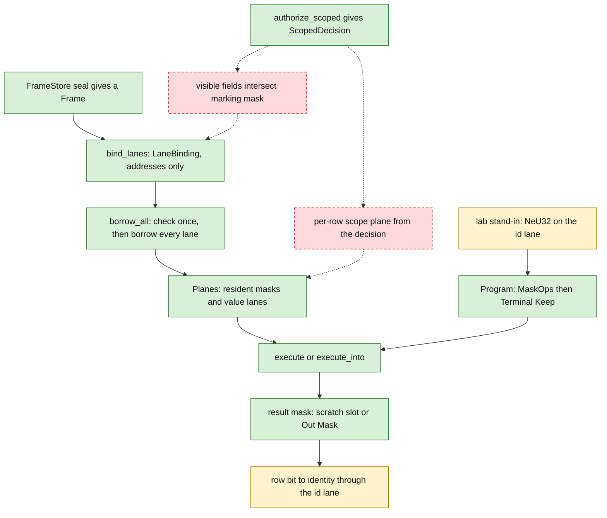
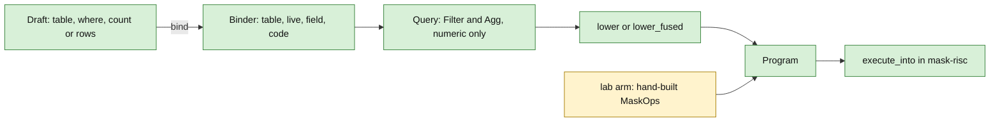
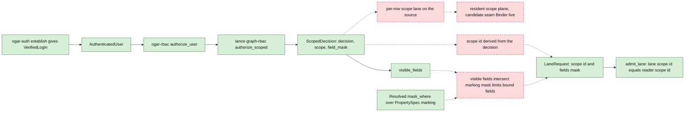

# 04 — Read path

Status: the read path from a sealed frame to a result mask is in code. The step that applies an authorization decision to that read is not built (gap G2).

Legend: green = in code on main, yellow = lab crate only, red dashed = gap (not built).

A governed read here means: the answer is computed over source-owned planes that were bound under a checked frame, and it comes back as a mask over the source's own row order.

## 4.1 One read, end to end

What each solid step does:

- **Seal.** A `FrameStore` issues the `Frame`. See [03](03-dr-dt64-binding.md).
- **Bind.** `bind_lanes` checks the store, frame, route, basis, row order and reader scope, and returns a `LaneBinding` that holds addresses only.
- **Borrow.** `borrow_all` runs the one check and yields every bound lane from the source. No lane is copied.
- **Planes.** The caller sorts borrowed lanes into `Planes`: mask planes and value lanes, all owned by the source.
- **Program.** A `Program` is a flat list of `MaskOp`s and one `Terminal`. `Terminal::Keep` leaves the final mask in place.
- **Execute.** `execute_into` runs the program one tile at a time. A `Keep` mask is written to the caller's `Out::Mask`, or read from its scratch slot when the scratch is one whole-population tile.
- **Identity.** In the lab, bit `r` of the result is physical row `r`, and the id lane gives the global identity at that row (`store_at`).

What the dashed edges say:

- A `ScopedDecision` exists (green). Nothing in the read path consumes it.
- The lab filters with a stand-in. `visible` is a `NeU32` predicate on the identity lane that denies exactly one fixed store id. It is a test stand-in, not an authorization.
- Two pieces are missing: a per-row scope plane built from the decision's `ScopeSpec`, and the intersection of `visible_fields()` with a marking mask to limit which fields get bound.

Sources:

- `crates/lance-graph-dt64/src/dr.rs:414-420` (`FrameStore::seal`)
- `crates/lance-graph-dt64/src/lane.rs:171-217` (`bind_lanes`)
- `crates/lance-graph-dt64/src/lane.rs:365-394` (`borrow_all`)
- `crates/lance-graph-mask-risc/src/ir.rs:71-81` (`Planes`)
- `crates/lance-graph-mask-risc/src/ir.rs:708-716` (`Program`)
- `crates/lance-graph-mask-risc/src/ir.rs:319-321` (`Terminal::Keep`)
- `crates/lance-graph-mask-risc/src/exec.rs:1318-1351` (`execute_into`, tiling, `Out::Mask`)
- `crates/lance-graph-mask-risc/src/value.rs:55-76` (`Out`)
- `crates/foundry-parity-lab/src/bind.rs:154-178` (lab `bind`: seal, then `bind_lanes`)
- `crates/foundry-parity-lab/src/arm_b.rs:139-188` (`ItemQuery::open`: `borrow_all`, planes sorted into masks and lanes)
- `crates/foundry-parity-lab/src/arm_b.rs:254-265` (`visible`, the stand-in)
- `crates/foundry-parity-lab/src/arm_b.rs:267-289` (`run`, `keep`)
- `crates/foundry-parity-lab/src/arm_b.rs:325-328` (`store_at`)
- `crates/foundry-parity-lab/src/fixture.rs:195` (`DENIED_STORE`)

## 4.2 How a program gets built

Two routes build a `Program`. Quack binds names and literals once into a numeric `Query` and lowers it. The lab writes `MaskOp`s by hand. Neither route evaluates anything. Evaluation is `execute`.

Reading notes:

- `Binder::live(table)` returns the plane every row of the table must pass. `Draft::bind` puts it first in the filter as `Filter::plane(...)`. It is the table's validity plane.
- After binding no text remains. A `Query` holds only fixed-width values.
- The Quack crate may build a `Program` and must never evaluate one. That rule is in its module doc.
- `TypedQuery` and `CodeWitness` let a binder vouch that a code space has not been renumbered between bind and use.

Sources:

- `crates/lance-graph-quack/src/bind.rs:1-30` (lifecycle: describe, resolve, canonicalize, execute numeric)
- `crates/lance-graph-quack/src/bind.rs:92-105` (`Binder`)
- `crates/lance-graph-quack/src/bind.rs:298-335` (`Draft::bind`, `live` plane first)
- `crates/lance-graph-quack/src/bind.rs:388-465` (`CodeWitness`, `TypedQuery`)
- `crates/lance-graph-quack/src/lib.rs:340-348` (`Filter`, `Filter::Plane`)
- `crates/lance-graph-quack/src/lib.rs:1297-1306` (`Query`)
- `crates/lance-graph-quack/src/lib.rs:1383-1399` (`lower`, `lower_fused`)
- `crates/lance-graph-quack/src/lib.rs:20-24` (the crate builds a `Program` and never evaluates one)
- `crates/foundry-parity-lab/src/arm_b.rs:267-276` (`run`: `Program::new` then `execute`)

## 4.3 The G2 gap: a decision that is not applied

The decision chain is complete up to `ScopedDecision`. The read path has a reader `Scope` that is only an id compared between a lane and a request. Nothing derives that scope from a decision.

What is built:

- `establish` is the only producer of a `VerifiedLogin`. `AuthenticatedUser` is a descriptive envelope.
- `OgarRbac::authorize_user` takes an `AuthenticatedUser` and calls the generic `authorize_scoped` kernel. `authorize_identity` is the membership variant.
- `ScopedDecision` carries the allow or deny verdict, an optional `ScopeSpec` (tenant, predicate key, path, deny) and a `WideFieldMask`. `visible_fields()` returns an empty mask unless access is allowed.
- `Resolved::mask_where` builds a mask from `PropertySpec.marking`.
- `LaneRequest` carries a reader `Scope` and a field mask. `admit_lane` refuses a lane whose scope id differs.

What is not built:

- No code in the dt64, quack, mask-risc, xlog, r2il or foundry-parity-lab crates names `authorize_scoped`, `ScopedDecision`, `lance_graph_rbac`, `ogar_rbac` or `ogar_auth`.
- No per-row scope lane exists on a source. A `ScopeSpec` therefore cannot become a plane.
- Where the decision is applied is not decided. `Binder::live` is a candidate seam because it is the plane every row must pass.
- No code derives the `Scope` id from a decision. No code intersects `visible_fields()` with a marking mask to restrict `bind_lanes`.

Sources:

- `OGAR/crates/ogar-auth/src/federation.rs:200-212` (`VerifiedLogin`, only producer is `establish`)
- `OGAR/crates/ogar-auth/src/federation.rs:250-266` (`establish`)
- `OGAR/crates/ogar-auth/src/user.rs:298-309` (`AuthenticatedUser`)
- `OGAR/crates/ogar-rbac/src/lib.rs:120-162` (`OgarRbac`, `authorize_user`)
- `OGAR/crates/ogar-rbac/src/lib.rs:322-335` (`authorize_identity`)
- `crates/lance-graph-rbac/src/authorize.rs:168-200` (`ScopedDecision`, `visible_fields`)
- `crates/lance-graph-rbac/src/authorize.rs:210-250` (`authorize_scoped`)
- `crates/lance-graph-rbac/src/authorize.rs:255-282` (`MembershipDecision`)
- `crates/lance-graph-contract/src/rbac.rs:113-132` (`ScopeSpec`)
- `crates/lance-graph-dt64/src/lib.rs:716-728` (`Resolved::mask_where`)
- `crates/lance-graph-contract/src/property.rs:769-783` (`Marking`)
- `crates/lance-graph-dt64/src/lane.rs:90-102` (`LaneRequest`)
- `crates/lance-graph-dt64/src/lane.rs:242-263` (`admit_lane`)
- `crates/lance-graph-dt64/src/dr.rs:518-523` (`Scope`: an opaque id)
- `crates/lance-graph-quack/src/bind.rs:92-97` (`Binder::live`)
- Absence claim: a text search of `crates/{lance-graph-dt64,lance-graph-quack,lance-graph-mask-risc,foundry-parity-lab,lance-graph-xlog,lance-graph-r2il}` (sources and Cargo.toml) for the five names above found no match. That is navigation over six named crates, not proof about the rest of the tree.
