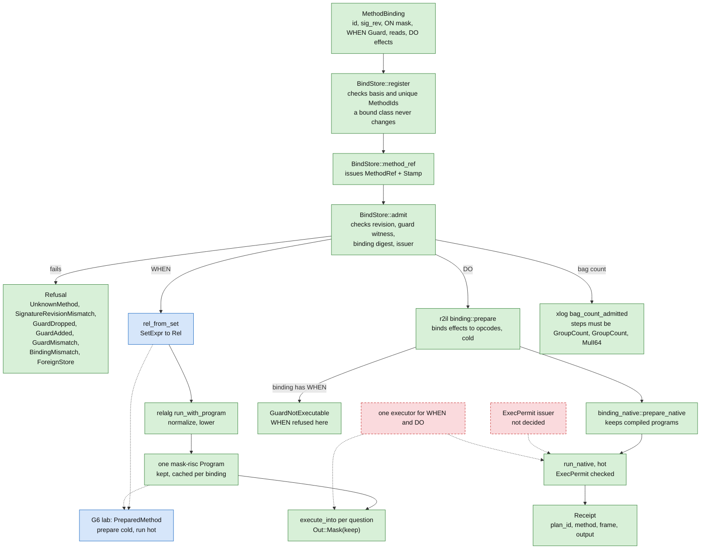
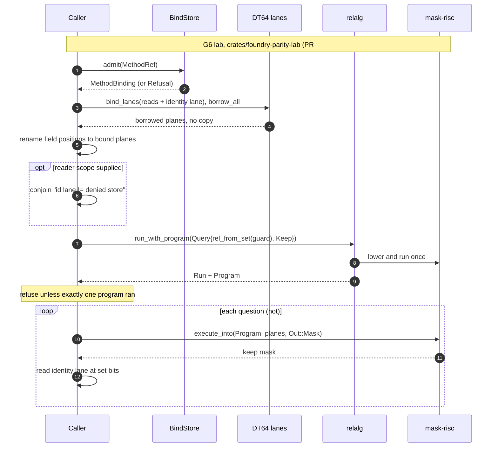
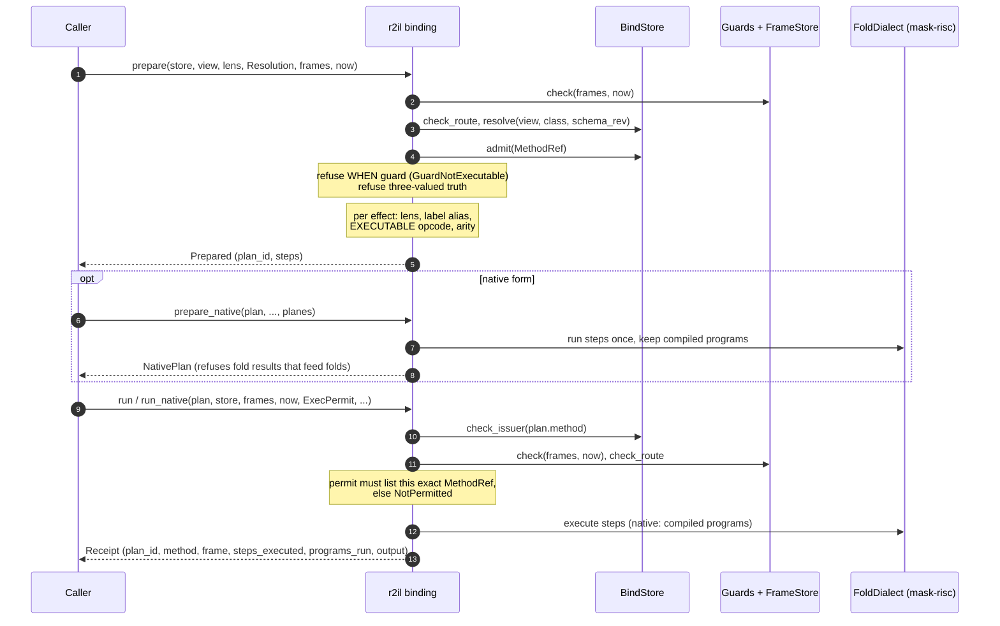

# 05 — Methods: ON x WHEN x DO

A method is a binding stored in DT64. It says which fields trigger it (ON),
which rows it applies to (WHEN), and what it writes (DO).
DT64 keeps the binding and executes nothing.
Other crates run the WHEN part and the DO part, and today they run them
separately.

Legend: solid edge = in code on main. Dashed edge = gap, not built.
Green = shipped on main. Yellow = lab crate only. Blue = open PR.
Red dashed = gap.

## 1. Method lifecycle

What the diagram shows:

- `register` is the only way a binding enters a store.
  `method_ref` is the only way a `MethodRef` is issued.
  Its `Stamp` has private fields, so a reference built elsewhere cannot carry
  a valid stamp.
- `admit` returns the stored binding only after all checks pass.
  The order is fixed: identity, signature revision, guard witness, binding
  digest, issuer.
- The WHEN path goes through relalg and ends in one mask-risc program.
  The code that holds and re-runs that program is the G6 lab
  (`PreparedMethod`).
  It lives on the open PR #1996 branch, not on main.
  `rel_from_set` is also new in that PR.
- The DO path is r2il.
  `prepare` runs once and is cold.
  `run` and `run_native` are hot and check the frame, focus, scope, route and
  an explicit `ExecPermit`.
- r2il refuses a binding that has a WHEN guard.
  The lab runs WHEN and r2il runs DO.
  Nothing yet runs both for one method.
- `ExecPermit` is documented as a lab permission.
  Who issues it is not decided.

Sources:

- `crates/lance-graph-dt64/src/lib.rs:1-27` (what DT64 stores, nothing executes)
- `crates/lance-graph-dt64/src/lib.rs:170-196` (`Guard`, `witness`)
- `crates/lance-graph-dt64/src/lib.rs:215-231` (`MethodBinding`: id, sig_rev, on, when, reads, effects)
- `crates/lance-graph-dt64/src/lib.rs:353-374` (`MethodRef`, `Stamp`, private fields)
- `crates/lance-graph-dt64/src/lib.rs:473-575` (`Refusal` arms; 554, 555, 562, 564, 566, 571, 574)
- `crates/lance-graph-dt64/src/lib.rs:814-823` (`register`)
- `crates/lance-graph-dt64/src/lib.rs:1136-1157` (`method_ref`)
- `crates/lance-graph-dt64/src/lib.rs:1161-1167` (`check_issuer`)
- `crates/lance-graph-dt64/src/lib.rs:1180-1211` (`admit`, fixed check order)
- `crates/lance-graph-relalg/src/lower.rs:70-100` (`run_with_program`; `symbolic` answer returns no program)
- `crates/lance-graph-relalg/src/ir.rs:99-119` (`Measure`, `Query`)
- `crates/lance-graph-relalg/src/normalize.rs:82` (`to_set`, on main)
- `crates/lance-graph-relalg/src/normalize.rs:124-130` (`rel_from_set`, PR #1996 branch only)
- `crates/foundry-parity-lab/src/method.rs:200-292` (`PreparedMethod::prepare`, PR #1996)
- `crates/lance-graph-r2il/src/binding.rs:1-73` (module doc: prepare/run, what is checked when)
- `crates/lance-graph-r2il/src/binding.rs:125-131` (`ExecPermit`: "not decided")
- `crates/lance-graph-r2il/src/binding.rs:251-252`, `:336-338` (`GuardNotExecutable`)
- `crates/lance-graph-r2il/src/binding_native.rs:1-42` (native plan, hot run allocates nothing)
- `crates/lance-graph-xlog/src/lib.rs:363-405` (`BoundRefusal`, `bag_count_admitted`)

## 2. WHEN: prepare once, run per question (lab)

Notes:

- The guard is a `SetExpr` over field positions.
  Mask fields are `Sym(field)`.
  Value fields are comparisons on a lane.
- The lab keeps the one program relalg returns.
  It refuses with `MethodRefusal::Folds` if the guard lowered into more than
  one fold, because the last program alone would not be the whole answer.
- The reader scope in the lab is a stand-in written into the program.
  It is not the RBAC decision.
  See `06-authorization.md`.
- Arm C of the lab refuses a cost question with `CostRefusal::NotBound` when
  a demanded cost lane is not bound.
  That arm is merged (#1995) and is separate from the method path.

Sources:

- `crates/foundry-parity-lab/src/method.rs:47-61` (`can_cook_guard`) (PR #1996)
- `crates/foundry-parity-lab/src/method.rs:77-94` (`can_cook_method`: `when: Some(Guard::new(...))`, `reads`) (PR #1996)
- `crates/foundry-parity-lab/src/method.rs:105-135` (`MethodRefusal`, including `Folds`) (PR #1996)
- `crates/foundry-parity-lab/src/method.rs:211-292` (`prepare`: admit `:217`, `borrow_all` `:229`, rename `:251`, scope `:252-257`, `run_with_program` `:264-272`, one-fold check `:276-280`) (PR #1996)
- `crates/foundry-parity-lab/src/method.rs:295-320` (`run`: `execute_into` `:302-309`, identity read) (PR #1996)
- `crates/lance-graph-relalg/src/lower.rs:70-100` (`run_with_program`)
- `crates/lance-graph-mask-risc/src/exec.rs:1343` (`execute_into`)
- `crates/foundry-parity-lab/src/arm_c.rs:66-92` (`CostRefusal::NotBound`, on main)

## 3. DO: prepare cold, run hot (r2il)

Notes:

- `run` never reads the `ClassView` or the vocabulary again.
  It rechecks the issuer, guards, route and permit, then runs the bound
  opcodes.
- `admit` succeeding is not permission to run.
  The permit must list the exact `MethodRef`.
- The `Receipt` is bounded by the number of steps.
  It is not a row trace and not the logical provenance of the answer.
- `run_native` also refuses with `PlanesChanged` when the planes have another
  shape than the ones the plan was prepared over.
- xlog has its own admitted path.
  `bag_count_admitted` accepts a `MethodBinding` only when it is a bag
  (`Population::Bag`) and its steps are `GroupCount`, `GroupCount`, `MulI64`.
  The intake re-checks its `MapTable` frame on every query.

Sources:

- `crates/lance-graph-r2il/src/binding.rs:12-61` (lifecycle, what is checked when)
- `crates/lance-graph-r2il/src/binding.rs:125-131` (`ExecPermit`)
- `crates/lance-graph-r2il/src/binding.rs:165-176` (`Prepared`, `plan_id`)
- `crates/lance-graph-r2il/src/binding.rs:223-231` (`Receipt`)
- `crates/lance-graph-r2il/src/binding.rs:236-317` (`ExecRefusal`)
- `crates/lance-graph-r2il/src/binding.rs:321-355` (`prepare`)
- `crates/lance-graph-r2il/src/binding.rs:377-404` (`run`)
- `crates/lance-graph-r2il/src/binding_native.rs:1-42` (native plan)
- `crates/lance-graph-r2il/src/binding_native.rs:203-216` (`prepare_native`)
- `crates/lance-graph-r2il/src/binding_native.rs:351-417` (`run_native`: permit, `PlanesChanged`)
- `crates/lance-graph-xlog/src/lib.rs:363-405` (`bag_count_admitted`)

## Open items on this page

- One executor that runs WHEN and DO for the same method: not built.
  The plan lists it as the missing contract for the computed-function row.
- The `ExecPermit` issuer: undecided.
  A natural candidate is the `Operation::Act` decision in `lance-graph-rbac`.
  That is a candidate only.
  See `06-authorization.md`.
- The lab (`PreparedMethod`, `rel_from_set`) is on PR #1996 and is not merged.
