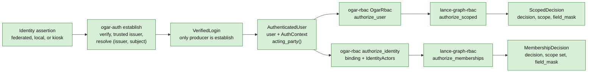
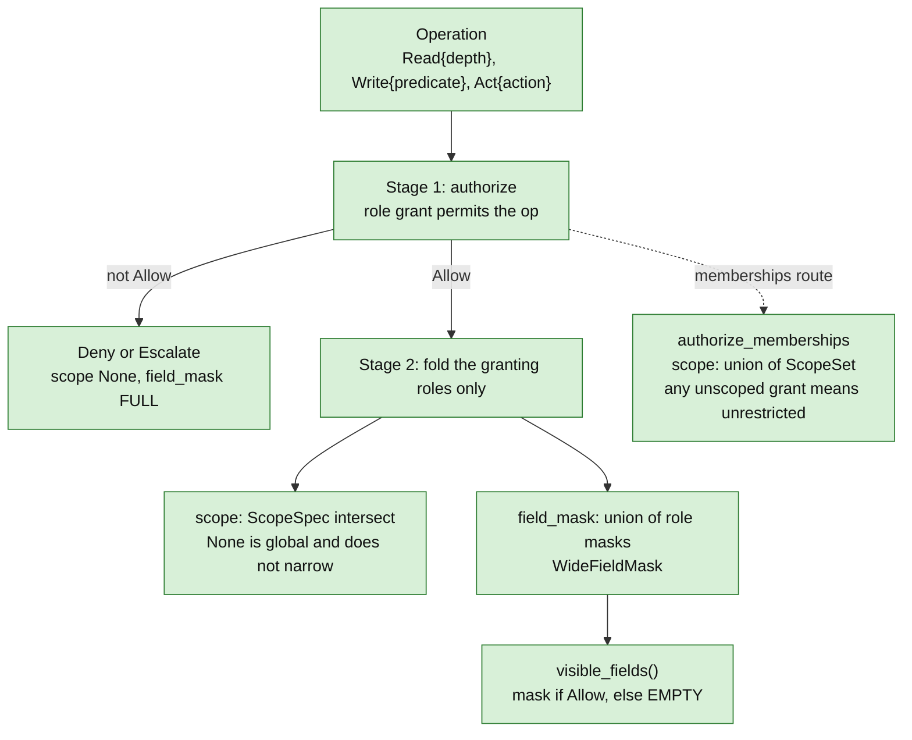
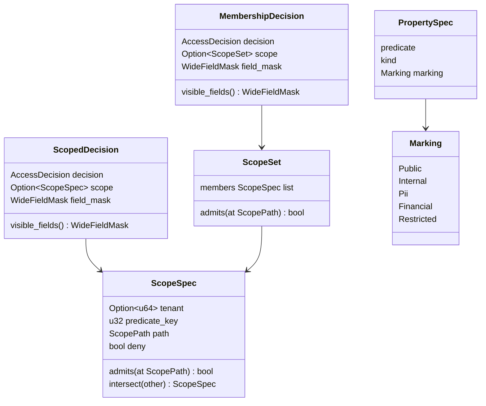
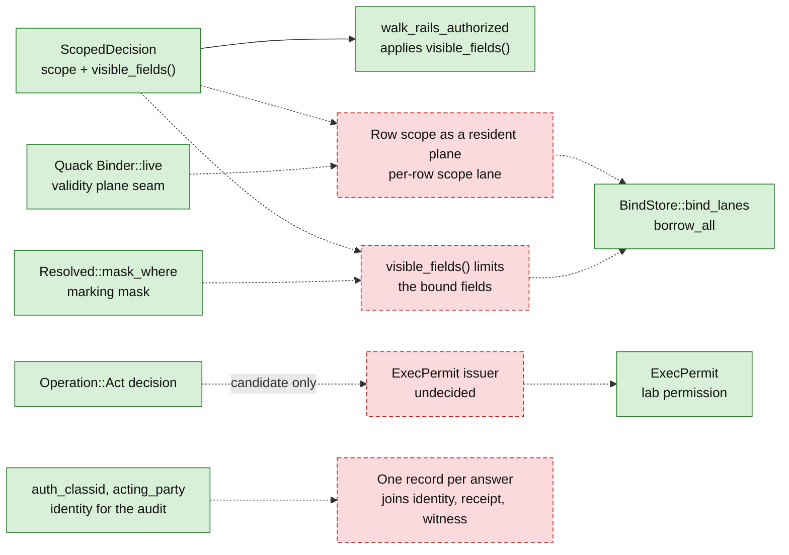

# 06 — Authorization

A login becomes an authenticated user.
The user and an operation go to an RBAC kernel.
The kernel returns a decision: allow or refuse, a row scope and a set of
visible fields.
That decision exists today.
Nothing yet applies it to a DT64 binding.

Legend: solid edge = in code on main. Dashed edge = gap, not built.
Green = shipped. Red dashed = gap.
The OGAR crates are in the OGAR repository, not in lance-graph.

## 1. From login to decision

What the diagram shows:

- `establish` runs in a fixed order.
  The verifier runs first.
  The asserted issuer must then be trusted.
  The `(issuer, subject)` must then resolve to a user.
  There is no fallback to email.
- `VerifiedLogin` has private fields and no public constructor.
  `AuthenticatedUser` has public fields.
  It is descriptive: building one proves nothing about how the actor logged in.
  Refusing unauthenticated actors is a deployment policy, not a grant rule.
- `OgarRbac::authorize_user` takes an `AuthenticatedUser`, not a bare actor
  string.
  It calls the generic kernel `authorize_scoped` and adds only the identity.
- `authorize_identity` is the second route.
  It binds every membership of the user to the user's tenant and calls
  `authorize_memberships`.
  It returns a `MembershipDecision`, not a `ScopedDecision`.
- A delegated login authorizes as the user whose authority the token carries.
  The acting party is recorded and holds no role.

Sources:

- `OGAR/crates/ogar-auth/src/federation.rs:206-216` (`VerifiedLogin`, private fields)
- `OGAR/crates/ogar-auth/src/federation.rs:244-283` (`establish`, fixed order, no fallback)
- `OGAR/crates/ogar-auth/src/user.rs:290-335` (`AuthenticatedUser`: descriptive, `actor_context`, `acting_party`)
- `OGAR/crates/ogar-rbac/src/lib.rs:1-36` (crate doc: the chain, where the kernel lives)
- `OGAR/crates/ogar-rbac/src/lib.rs:70-71` (imports `authorize_scoped`, `authorize_memberships`)
- `OGAR/crates/ogar-rbac/src/lib.rs:122-162` (`OgarRbac`, `authorize_user`, kiosk note)
- `OGAR/crates/ogar-rbac/src/lib.rs:225-345` (`IdentityActors`, delegation, `authorize_identity`)
- `crates/lance-graph-rbac/src/authorize.rs:210-253` (`authorize_scoped`)
- `crates/lance-graph-rbac/src/authorize.rs:299-345` (`authorize_memberships`)

## 2. Inside the kernel

Notes:

- On a refused decision `field_mask` holds the open default (`FULL`).
  Use `visible_fields()` for any output stage.
  It returns `EMPTY` unless the decision is `Allow`.
- `authorize_scoped` intersects the scopes of the granting roles.
  One more role can only narrow what the actor sees.
  `authorize_memberships` is the permissive counterpart.
  Each granting membership adds its own scope, and the scopes are unioned.
- `Operation::Write` names a predicate.
  `Operation::Act` names an action.
  `Operation::Read` carries a depth.
  The grant gate is a verb bit per class (`OpMask`: READ, WRITE, CREATE,
  DELETE, ACT).
  A finer check on depth, predicate or action name layers above it.

Sources:

- `crates/lance-graph-contract/src/rbac.rs:340-364` (`Operation`: Read, Write, Act)
- `crates/lance-graph-contract/src/rbac.rs:453-466` (`OpMask`, ACT bit)
- `crates/lance-graph-contract/src/rbac.rs:548-550` (`grants_permit`)
- `crates/lance-graph-rbac/src/authorize.rs:164-208` (`ScopedDecision`, `visible_fields`)
- `crates/lance-graph-rbac/src/authorize.rs:210-253` (stage 1 short-circuit, stage 2 fold)
- `crates/lance-graph-rbac/src/authorize.rs:255-345` (`MembershipDecision`, `authorize_memberships`)
- `crates/lance-graph-rbac/src/access.rs:5-13` (`AccessDecision`: Allow, Deny, Escalate)

## 3. The shape of a decision

Notes:

- `ScopeSpec::admits` is address containment.
  It is true when the scope is not `deny` and the row's path lies at or below
  the scope's path.
  The tenant is matched by the store that owns the rows.
- `intersect` never widens.
  `deny` absorbs.
  Two paths on different branches give `DENY`.
  Two different tenants give `DENY`.
  A `None` tenant (global) takes the other side's tenant.
- `predicate_key` is reserved.
  It is OR-combined and not interpreted.
- `Marking` is a data classification on each `PropertySpec`.
  The default is `Internal`.
  DT64's `Resolved::mask_where` builds a field mask from meaning, for example
  every field with marking at or above `Pii`.
  That mask is a way to select fields.
  It is not an authorization decision.

Sources:

- `crates/lance-graph-contract/src/rbac.rs:114-132` (`ScopeSpec` fields)
- `crates/lance-graph-contract/src/rbac.rs:144-151` (`admits`)
- `crates/lance-graph-contract/src/rbac.rs:153-191` (`intersect`)
- `crates/lance-graph-contract/src/rbac.rs:236-267` (`ScopeSet`, `admits`)
- `crates/lance-graph-contract/src/rbac.rs:302-308` (`Membership`)
- `crates/lance-graph-rbac/src/authorize.rs:164-208`, `:255-278` (decision structs)
- `crates/lance-graph-contract/src/property.rs:41-58` (`PropertySpec.marking`)
- `crates/lance-graph-contract/src/property.rs:768-783` (`Marking`)
- `crates/lance-graph-dt64/src/lib.rs:714-723` (`mask_where`)
- `crates/lance-graph-contract/src/selection.rs:308-360` (`walk_rails_authorized`: applies `visible_fields()`, decides nothing)

## 4. What is not built

What is missing:

- **Applying the decision to a DT64 binding (plan G2).**
  The decision exists.
  No DT64, r2il, xlog, Quack or mask-risc code uses `lance-graph-rbac`.
  A per-row scope lane on the source and a rule that limits bound fields to
  `visible_fields()` are not built.
  The lab uses a stand-in: one reader denied one store id, written into the
  program.
  It is not IAM.
  Quack's `Binder::live` is named in the plan as the existing seam where a
  scope plane could enter.
- **The `ExecPermit` issuer.**
  The r2il source says who issues the permit is not decided.
  The `Operation::Act` decision is a natural candidate.
  That is a candidate only.
- **Provenance.**
  `ResolvedIdentity::auth_classid` is documented as the identity for the audit.
  Receipts and commit witnesses exist elsewhere.
  Nothing joins them into one record per answer.

Sources:

- `crates/lance-graph-rbac/Cargo.toml:1-9` (depends on `lance-graph-contract` only)
- `crates/lance-graph-r2il/src/binding.rs:125-131` (`ExecPermit`: "who issues it is not decided")
- `crates/lance-graph-quack/src/bind.rs:91-97` (`Binder::live`)
- `crates/lance-graph-dt64/src/lane.rs:171`, `:379` (`bind_lanes`, `borrow_all`)
- `crates/lance-graph-contract/src/selection.rs:308-360` (`walk_rails_authorized`)
- `crates/lance-graph-rbac/src/auth.rs:376-381` (`auth_classid`)
- `crates/foundry-parity-lab/src/method.rs:14-16`, `:252-257` (reader scope stand-in) (PR #1996)
- `.claude/plans/foundry-parity-v1.md` §0 and §7 G2 on branch `ccr-ca0562e7-hudvlz` (the gap statement; "candidate" wording)
- A search of the DT64, r2il, xlog, Quack and mask-risc crates for `rbac` and `ScopedDecision` finds no use. This is a search, so it shows candidates only; the Cargo.toml dependency lists agree.
