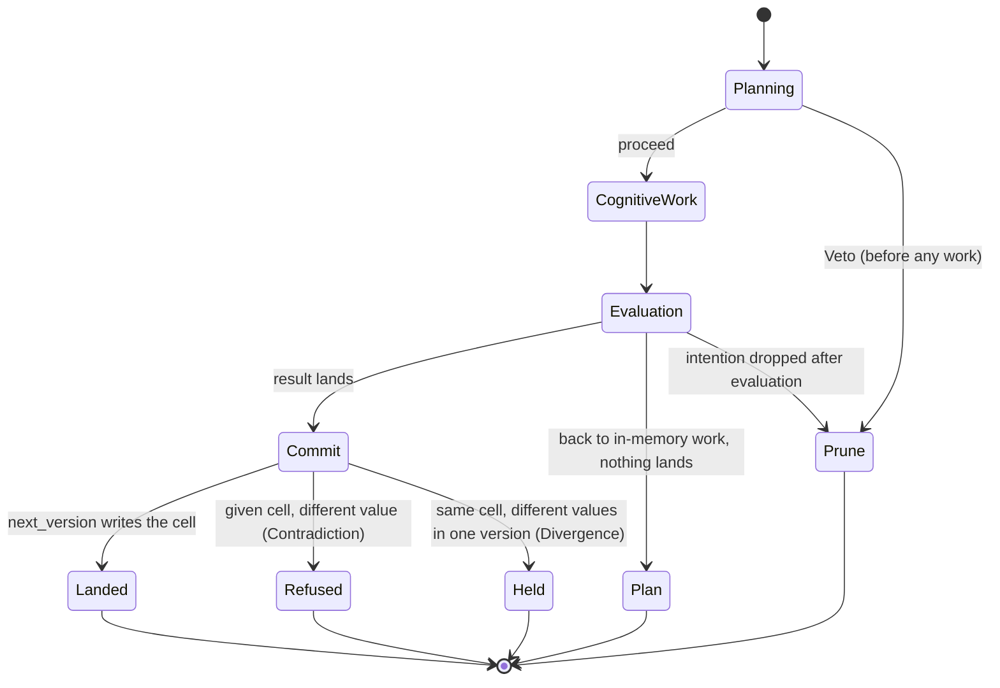
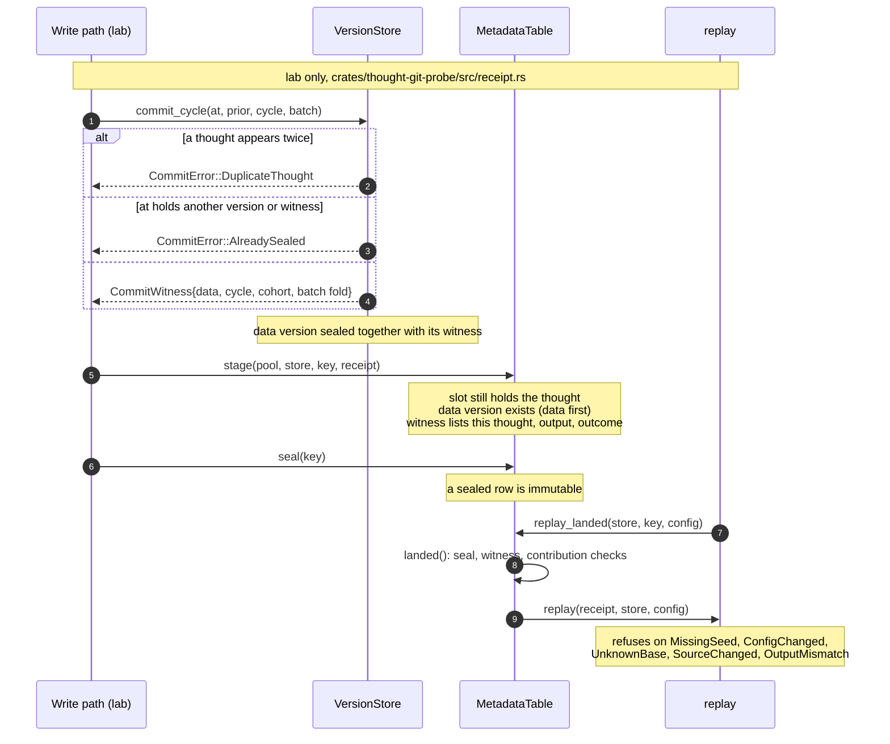
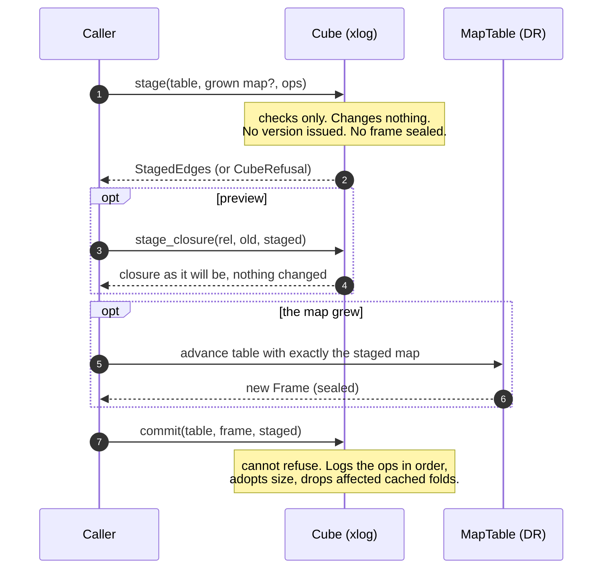
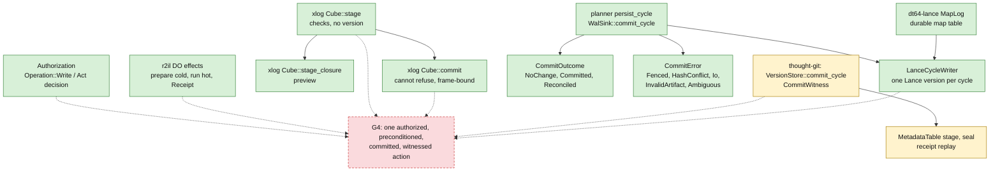

# 07 — Write path

The pieces of a write exist.
A thought ends in one of four outcomes.
A cycle of thoughts commits as one version.
A receipt can replay a thought after its slot is gone.
A cube can check a batch of edges before it changes.
A durable map table already goes through the cycle writer.
These pieces are not composed into one write-back that is authorized,
preconditioned, committed and witnessed.
That composition is gap G4 in the parity plan.

Legend: solid edge = in code on main. Dashed edge = gap, not built.
Green = shipped on main. Yellow = lab crate only. Red dashed = gap.
`thought-git-probe` is a lab crate with its own workspace root.
Its `VersionStore` stands in for Lance and has no Lance storage.

## 1. The Rubicon: how a thought ends

Rules from the oracle (lab):

1. Only a thought whose outcome is `Commit` lands.
   `Plan`, `Prune` and `Veto` leave the version unchanged.
2. A cell with a given value (layer 0) is never overwritten.
   The same value is agreement and is not stored.
   A different value is refused and recorded as a `Contradiction`.
3. A cell without a given takes the landed value.
   If thoughts in one version offer different values, nothing is stored and a
   `Divergence` is recorded.
4. A cell nobody wrote reads as absent, never as zero.

Sources:

- `crates/thought-git-probe/src/fixtures.rs:30-41` (`Outcome`: Commit, Plan, Prune, Veto)
- `crates/thought-git-probe/src/oracle.rs:1-15` (the four rules)
- `crates/thought-git-probe/src/oracle.rs:50-122` (`next_version`, `Contradiction`, `Divergence`)
- `crates/thought-git-probe/src/slots.rs:1-26` (slot 0 is the givens, 63 live slots, `branch`, `free`)

## 2. Landing a cycle and keeping a receipt

What this gives and what it does not:

- `commit_cycle` seals one data version for a whole cycle.
  The `CommitWitness` records the cycle and every thought in the cohort with
  its output fold and outcome.
  Every thought is in the cohort, whatever its outcome.
- A receipt records what is needed to recompute a thought's writes: the sealed
  base it read, the program, the seed, the configuration, a fold of the values
  read and a fold of the writes.
  Replay recomputes both folds and refuses on any difference.
  It never reads the old slot.
- The witness is a fold, not a cryptographic proof.
  Data and metadata are two writes.
  A crash between them leaves a committed thought without a sealed row.
  `MetadataTable::incomplete` reports it.
  No atomicity across the two is claimed.
- `BaseRef` stands in for a durable reference that has no contract type yet.
  `VersionStore::commit_cycle` stands in for the coalesced per-cycle commit
  of the real cycle writer.

Sources:

- `crates/thought-git-probe/src/receipt.rs:1-45` (module doc, what is a stand-in)
- `crates/thought-git-probe/src/receipt.rs:54-113` (`BaseRef`, `VersionStore`, `Contribution`, `CommitWitness`, `CommitError`)
- `crates/thought-git-probe/src/receipt.rs:153-185` (`commit_cycle`)
- `crates/thought-git-probe/src/receipt.rs:368-407` (`Receipt`, `ReceiptIdentity`)
- `crates/thought-git-probe/src/receipt.rs:426-476` (`Refusal` arms)
- `crates/thought-git-probe/src/receipt.rs:564-600` (`replay`)
- `crates/thought-git-probe/src/receipt.rs:618-692` (`MetaKey`, `MetaRow`, `contribution_check`)
- `crates/thought-git-probe/src/receipt.rs:697-847` (`MetadataTable`: `stage`, `seal`, `landed`, `incomplete`, `replay_landed`)

## 3. A batch of edges: check, preview, apply (xlog)

Notes:

- `stage` takes `&self`.
  It checks that a grown map extends the tile's current map.
  It checks that every id is placed under the resulting layout.
  A map that renumbers is refused with `Renumbered`.
- `commit` takes `&mut self`.
  It cannot refuse because every check ran in `stage`.
  The frame must be the one sealed after the table advanced with exactly the
  staged map.
  A batch staged by another cube is a caller bug and is not applied.
- The log is the cube's in-memory delta log.
  It is not a Lance version.
- `bag_count_admitted` is a separate xlog entry that runs only from a method
  the bind store admitted.
  See `05-methods.md`.

Sources:

- `crates/lance-graph-xlog/src/cube.rs:60-92` (`EdgeOp`, `StagedEdges`)
- `crates/lance-graph-xlog/src/cube.rs:838-907` (`stage`)
- `crates/lance-graph-xlog/src/cube.rs:909-933` (`stage_closure`)
- `crates/lance-graph-xlog/src/cube.rs:932-975` (`commit`)
- `crates/lance-graph-xlog/src/cube.rs:979-990` (`rebase`, extension check)
- `crates/lance-graph-xlog/src/lib.rs:28-39` (frame re-check)

## 4. The pieces, and the composition that is missing

What is built:

- **Durable map table (PR #1993, merged).**
  `MapLog` makes DR's versioned global-to-local table durable through the
  cycle writer.
  An advance is one cycle.
  The route version is claimed when the advance is built.
  It is applied to the table only after the cycle's seal ticket resolves
  `Ok`.
  A failed seal applies nothing, and its version is a gap in the table and in
  the store.
  Restore replays every sealed cycle at its own route version.
- **The cycle writer.**
  `WalSink::commit_cycle` takes an already ordered and hashed batch and
  publishes one new dataset version, all or nothing.
  It looks the batch up by `(cycle, batch_hash)` first, so a retry after a
  lost acknowledgement returns `Reconciled` and does not append twice.
  Zero artifact casts return `NoChange` and never call the sink.
- **A commit that cannot say "nothing landed" after publication.**
  There is no such result state.
  The case reconciles or surfaces as `Ambiguous`.

What is not built (G4):

- Nothing joins an authorization decision, a DO effect, a precondition check,
  a commit and a witness for one action.
- `Cube::commit` changes the cube's in-memory log.
  It does not write a Lance version.
- The probe's `CommitWitness` is not wired into the real cycle writer.
  The probe's own doc names that wiring as an admission decision still to be
  made.
- The authorization decision is not applied on this path.
  See `06-authorization.md`.
- The plans for the full thought-git API and lifecycle are a proposal and a
  contract (docs only).
  No production land, rebase or persistence pipeline for thought-git exists.

Sources:

- `crates/lance-graph-planner/src/persist_sink.rs:200-300` (`CommitOutcome`, `CommitError`, `LandedSlot`, `FrameMeta`)
- `crates/lance-graph-planner/src/persist_sink.rs:520-640` (`WalSink::commit_cycle`, reconciliation first, `persist_cycle` artifact gate, `NoChange`)
- `crates/lance-graph/src/graph/cycle_sink.rs:170`, `:1047` (`LanceCycleWriter`, `impl WalSink`)
- `crates/lance-graph-dt64-lance/src/lib.rs:1-45` (design: cycle writer, one advance is one cycle, restore)
- `crates/lance-graph-dt64-lance/src/lib.rs:270-325` (`advance`, `settle`)
- `crates/lance-graph-dt64-lance/Cargo.toml:1-25` (own workspace root; excluded from the lance-graph workspace)
- `crates/lance-graph-xlog/src/cube.rs:838-975` (`stage`, `stage_closure`, `commit`)
- `crates/thought-git-probe/src/lib.rs:1-14` (no production land, rebase or persistence pipeline)
- `crates/thought-git-probe/src/receipt.rs:39-45` (stand-ins; wiring is D-TGB-7's admission decision)
- `crates/lance-graph-r2il/src/binding.rs:223-231` (`Receipt`)
- `.claude/plans/foundry-parity-v1.md` §0 on branch `ccr-ca0562e7-hudvlz` (the G4 row: pieces exist, not composed)

## Open items on this page

- G4: the composition above.
  It needs the authorization decision, the DO effects, a precondition check
  and the cycle writer joined in one path.
- Scenario overlay (G3): branches exist (`SlotPool::branch`, `stage_closure`).
  An overlay frame that a DT64 binding can read is not built.
- Provenance: receipts, commit witnesses and the authentication identity each
  exist.
  One record per answer that joins them is not built.
