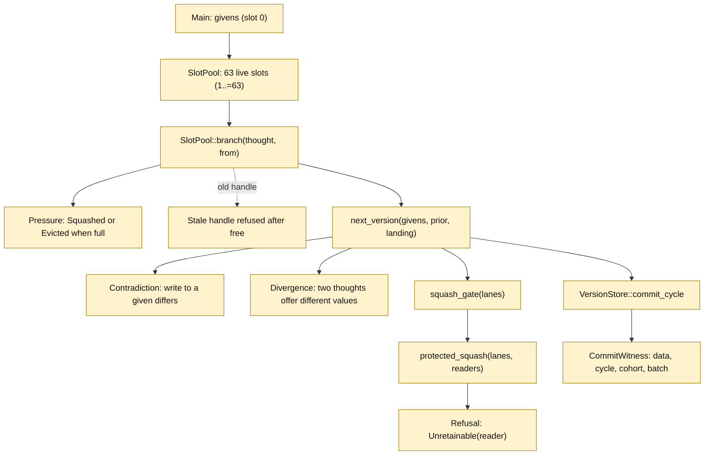
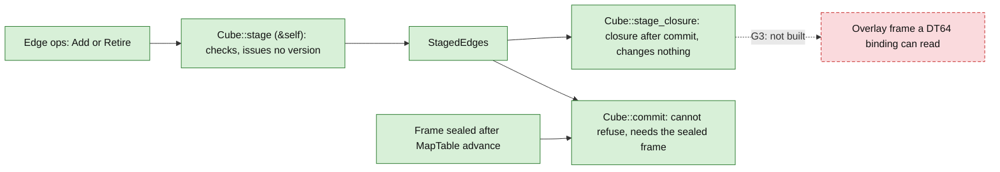
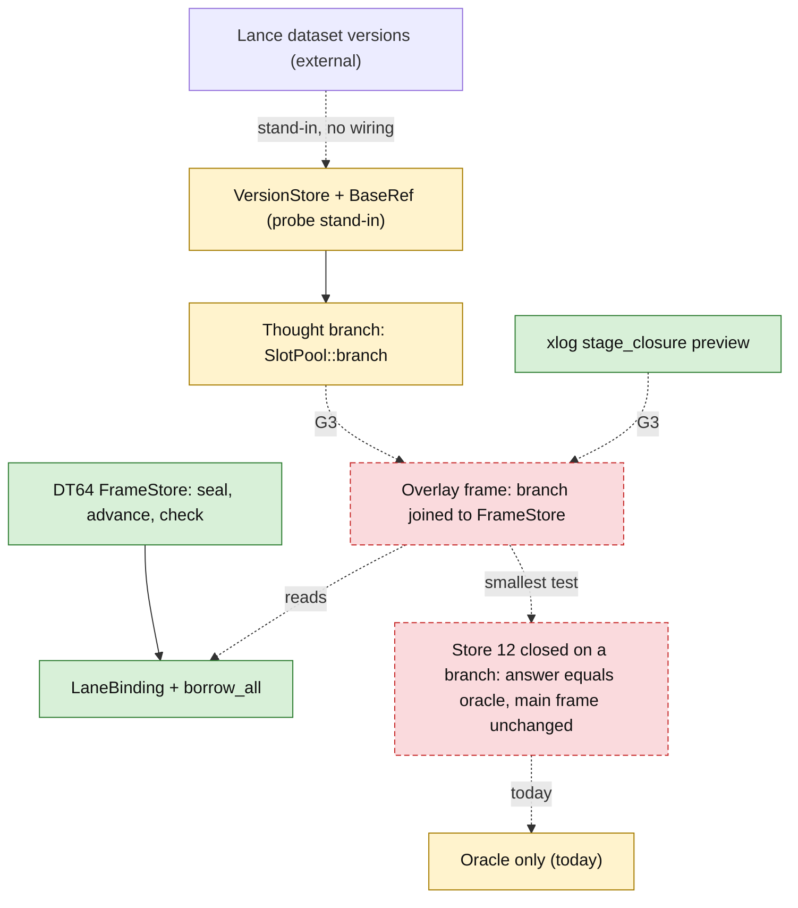

# 08 — Scenarios: what-if branches

This page shows what exists for "what if" work, and the one piece that does not.
Branches and previews exist in two lab crates. A DT64 binding cannot read a branch yet.
That join is gap G3 and is drawn dashed.

Status classes: green = in code on main. Yellow = lab crate only. Blue = open PR. Red dashed = gap.

## 1. Branch, land, squash (thought-git-probe)

`thought-git-probe` is a lab probe. It is excluded from the workspace and has its own workspace root.
`VersionStore` is a probe stand-in for Lance, not Lance itself.
The probe has no scenario, overlay or sandbox type. The nearest pieces are the slot pool and the oracle.

What the diagram says:

- `branch` takes a free slot. It starts from main or from a live thought.
- When all 63 slots are taken, a candidate is squashed into a neighbour or evicted.
- `next_version` computes the next version from scratch. It records a `Contradiction` when a thought writes a different value to a given. It records a `Divergence` when two landing thoughts disagree on an absent cell.
- `squash_gate` refuses on a contradiction or a divergence. `protected_squash` also refuses when a protected reader could not be answered from what the squash keeps.
- `commit_cycle` seals one version per cycle and records a `CommitWitness`.

Sources:

- `crates/thought-git-probe/Cargo.toml:9-13` (own workspace root, one dependency on the contract crate)
- `crates/thought-git-probe/src/slots.rs:1-22` (slot 0 is the givens, 63 live slots, squash and evict rules)
- `crates/thought-git-probe/src/slots.rs:28` (`LIVE_SLOTS = 63`)
- `crates/thought-git-probe/src/slots.rs:49-64` (`Pressure::Squashed`, `Pressure::Evicted`)
- `crates/thought-git-probe/src/slots.rs:66-67` (`Stale`)
- `crates/thought-git-probe/src/slots.rs:104-138` (`SlotPool::branch`)
- `crates/thought-git-probe/src/oracle.rs:26-44` (`Contradiction`, `Divergence`)
- `crates/thought-git-probe/src/oracle.rs:66-107` (`next_version`)
- `crates/thought-git-probe/src/squash.rs:99-129` (`squash_gate`, refusals)
- `crates/thought-git-probe/src/squash.rs:182-196` (`Reader`, `Witness`)
- `crates/thought-git-probe/src/squash.rs:289-345` (`protected_squash`)
- `crates/thought-git-probe/src/receipt.rs:40-45` (`VersionStore` stands in for Lance)
- `crates/thought-git-probe/src/receipt.rs:153-185` (`commit_cycle`)

## 2. Preview without a commit (xlog)

`lance-graph-xlog` has a two-phase edge write. `stage` only checks. `stage_closure` shows the derived
result as it would be after the commit, and changes nothing. `commit` cannot refuse.

Sources:

- `crates/lance-graph-xlog/src/cube.rs:845-907` (`Cube::stage`, doc and body)
- `crates/lance-graph-xlog/src/cube.rs:905-930` (`Cube::stage_closure`)
- `crates/lance-graph-xlog/src/cube.rs:932-945` (`Cube::commit`)
- `.claude/plans/foundry-parity-v1.md (PR #1996):292` (G3 register row)

## 3. Lance versions as history, and the G3 gap

Lance itself keeps versions. In the probe, `VersionStore` and `BaseRef` stand in for them.
`BaseRef` stands in for a durable reference that has no contract type yet.
Nothing in `lance-graph-dt64`, `lance-graph-xlog` or the probe source joins a branch to a DT64
`FrameStore`. A search for "overlay" finds only a test name in the probe
(`tests/signals.rs:30`, `overlay_regressions`). The search is navigation, not proof of absence.

The smallest falsifier named for G3 is: close store 12 on a branch. The overlay answer must equal the
oracle, and the canonical frame must not change. It has not been written, because the overlay frame
does not exist.

Sources:

- `crates/thought-git-probe/src/receipt.rs:37-60` (`BaseRef`, `VersionStore` as stand-ins)
- `crates/lance-graph-dt64/src/dr.rs:379-426` (`FrameStore`, `seal`, `advance`)
- `crates/lance-graph-dt64/src/lane.rs:153,379` (`LaneBinding`, `borrow_all`)
- `crates/thought-git-probe/tests/signals.rs:30` (the only "overlay" name found in the three crates)
- `.claude/plans/foundry-parity-v1.md (PR #1996):133` (matrix row 13, PARTIAL)
- `.claude/plans/foundry-parity-v1.md (PR #1996):292` (G3: needs an overlay frame contract joining a thought-git branch to `FrameStore`)
- `.claude/plans/foundry-parity-v1.md (PR #1996):72` (checklist: P3 scenario overlay frame, open)
- `.claude/plans/foundry-parity-v1.md (PR #1996):328-329` (roadmap P3)
