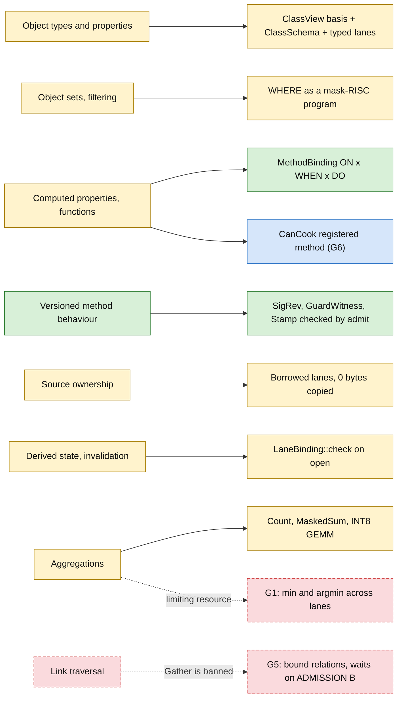
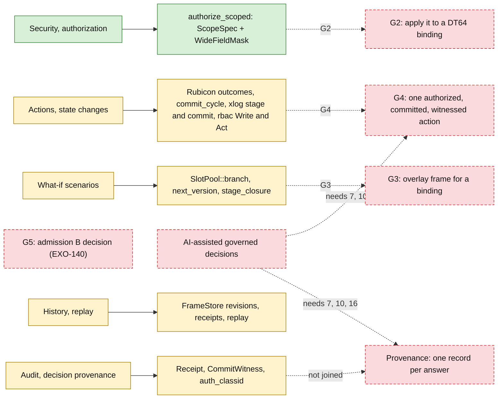
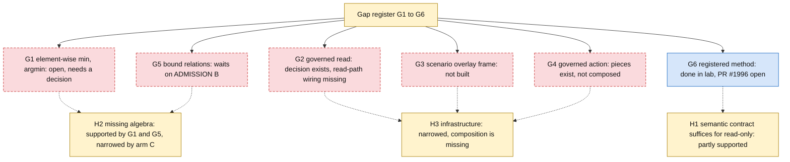

# 09 — Foundry parity: status map

**This is an evidence map, not a parity claim.** Nothing was compared against a running Foundry.
The plan's own contract grades Foundry parity as a hypothesis, and no matrix row is graded
"parity demonstrated". The Foundry column cites public documentation only. There is no graphical
low-code builder here.

The source of truth is `.claude/plans/foundry-parity-v1.md (PR #1996)`. That file lives on a branch with
an open PR, so line numbers below refer to that branch.

Status classes: green = in code on main. Yellow = lab crate only. Blue = open PR. Red dashed = gap.
Gray = not exercised.

## 1. The report in one table (plan section 0)

| Question | Path | Status |
|---|---|---|
| `CanCook` | hand-written mask-RISC program (arm B) | lab, merged |
| per-store cost | INT8 packed GEMM (arm C) | lab, merged (#1995) |
| `CanCook` as a registered method (G6) | admit, bind, lowered once by relalg, execute | lab, open PR #1996 |
| per-store maximum | layer-cake sweep over masks | lab, slow: no element-wise min or argmin |
| governed read, scenarios, write-back, joined provenance | pieces in other crates | not composed on this path |

Sources:

- `.claude/plans/foundry-parity-v1.md (PR #1996):12-44` (section 0 report)
- `.claude/plans/foundry-parity-v1.md (PR #1996):3-4` (status: level R lab merged, G6 in #1996)
- `crates/foundry-parity-lab/src/` holds `arm_a.rs`, `arm_b.rs`, `arm_c.rs`, `bind.rs`, `fixture.rs`, `oracle.rs`, `source.rs` on main. No `method.rs` there, so G6 is on the PR branch only.

## 2. Read side: capability to in-repo piece

Sources:

- `.claude/plans/foundry-parity-v1.md (PR #1996):119-125` (rows 1 to 5)
- `.claude/plans/foundry-parity-v1.md (PR #1996):126` (row 6, identity implemented, execution lab)
- `.claude/plans/foundry-parity-v1.md (PR #1996):129,132,134` (rows 9, 12, 14)
- `.claude/plans/foundry-parity-v1.md (PR #1996):123` (row 3, blocked)
- `.claude/plans/foundry-parity-v1.md (PR #1996):290,294` (G1, G5)
- `crates/lance-graph-dt64/src/lib.rs:215` (`MethodBinding`)
- `crates/lance-graph-dt64/src/lib.rs:772,1180` (`BindStore`, `admit`)
- `crates/lance-graph-dt64/src/lane.rs:153,379` (`LaneBinding`, `borrow_all`)

## 3. Governance side: capability to in-repo piece

The decision pieces exist. Applying them on a DT64 path is not built.

Sources:

- `.claude/plans/foundry-parity-v1.md (PR #1996):127,130,131,133,136,138` (rows 7, 10, 11, 13, 16, 18)
- `.claude/plans/foundry-parity-v1.md (PR #1996):291-293` (G2, G3, G4)
- `crates/lance-graph-rbac/src/authorize.rs:170-200` (`ScopedDecision`, `visible_fields`)
- `crates/lance-graph-rbac/src/authorize.rs:210` (`authorize_scoped`)
- `OGAR/crates/ogar-rbac/src/lib.rs:155,327` (`authorize_user`, `authorize_identity`)
- `crates/lance-graph-xlog/src/cube.rs:856,909,939` (`stage`, `stage_closure`, `commit`)
- `crates/thought-git-probe/src/receipt.rs:153` (`commit_cycle`)
- `crates/lance-graph-r2il/src/binding.rs:124-131` (`ExecPermit`: "who issues it is not decided")

## 4. Gap register and hypotheses

No hypothesis is chosen over the others. All three hold in part.
The next step with the most value is G2 in the lab, using `authorize_scoped` instead of the stand-in.

Sources:

- `.claude/plans/foundry-parity-v1.md (PR #1996):286-295` (missing-contract register G1 to G6)
- `.claude/plans/foundry-parity-v1.md (PR #1996):297-316` (hypotheses H1 to H3)
- `.claude/plans/foundry-parity-v1.md (PR #1996):41-42` (next step)
- `.claude/plans/foundry-parity-v1.md (PR #1996):318-331` (roadmap P0 to P5)

## 5. Table version

Foundry capabilities are as documented in the plan. Status uses the four classes above, or "not exercised".
The verdict column repeats the plan's grading. No row is "parity demonstrated".

| # | Foundry capability | In-repo piece | Status | Plan verdict |
|---|---|---|---|---|
| 1 | Object types, typed properties | `ClassView` basis, `ClassSchema`, typed lanes | lab | functionally related |
| 2 | Stable identity, provenance | DR route, witnessed coordinate, id lane | lab; per-value provenance gap | partial, provenance missing |
| 3 | Link traversal | relation lanes, `graph_hop` (feature-gated off) | gap | blocked (G5) |
| 4 | Object sets, filtering | WHERE as a mask program | lab | functionally related; lower-level advantage is a hypothesis |
| 5 | Computed properties, functions | `MethodBinding` + `MethodRef`; r2il DO effects | lab (G6 on open PR #1996) | functionally related |
| 6 | Versioned method behaviour | `SigRev`, `GuardWitness`, `Stamp` checked by `admit` | shipped (identity), lab (execution) | functionally related, read-only |
| 7 | Actions, state changes | thought-git write path, xlog stage and commit, rbac Write and Act | lab pieces; composition gap | partial |
| 8 | Multiple sources, sync | `LaneSource` per owner, `FrameStore` per source | lab, one source only | blocked |
| 9 | Source ownership | borrowed lanes, one owner | lab | lower-level advantage is a hypothesis |
| 10 | Security, authorization | `authorize_scoped` decision | shipped (decision); gap (applied on DT64 path, G2) | partial |
| 11 | History, replay | `FrameStore` revisions, receipts, replay | lab | partial |
| 12 | Derived state, invalidation | `LaneBinding::check` | lab | functionally related |
| 13 | What-if scenarios | `SlotPool::branch`, `next_version`, `stage_closure` | lab; overlay frame gap (G3) | partial |
| 14 | Aggregations | `Count`, `MaskedSumI32`, INT8 GEMM | lab; min and argmin gap (G1) | partial |
| 15 | Operational applications | a2ui-rs, consumer objects | not exercised | not comparable here |
| 16 | Audit, decision provenance | `LaneBinding`, `Receipt`, `CommitWitness`, `auth_classid` | lab pieces, not joined | partial |
| 17 | Data connections, egress | source adapters | not exercised | not comparable here |
| 18 | AI-assisted governed decisions | none on this path | gap | missing |

Notes on the plan's own text:

- Row 7 of the plan calls PR #1993 "open". It has since merged (`b34d195` on main): durable map-table writes through the cycle writer are now on main.
- `ExecPermit` has no decided issuer. The plan names an `Operation::Act` decision in `lance-graph-rbac` as the natural candidate. That is a candidate, not a decision.

Sources:

- `.claude/plans/foundry-parity-v1.md (PR #1996):111-138` (matrix and legend)
- `.claude/plans/foundry-parity-v1.md (PR #1996):113-117` (status and verdict vocabulary)
- `.claude/plans/foundry-parity-v1.md (PR #1996):295` (G6 row: issuer candidate)
- `crates/lance-graph-r2il/src/binding.rs:124-128` (`ExecPermit` doc)
