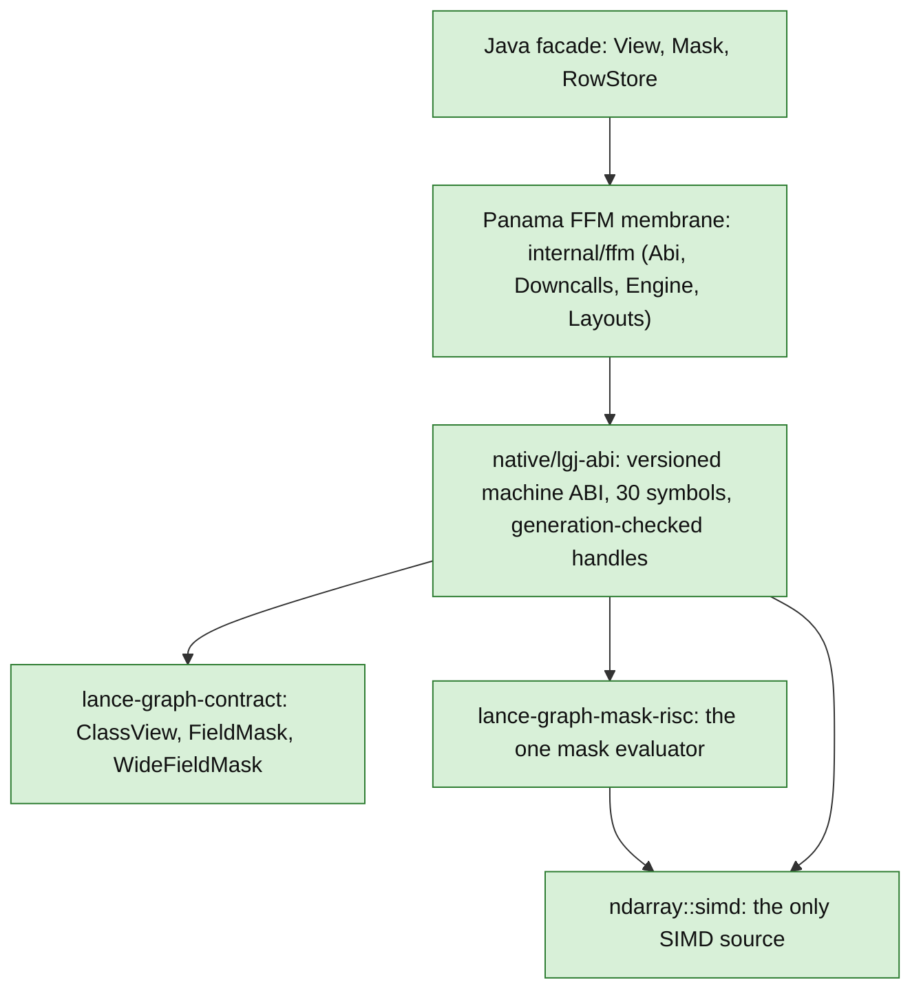
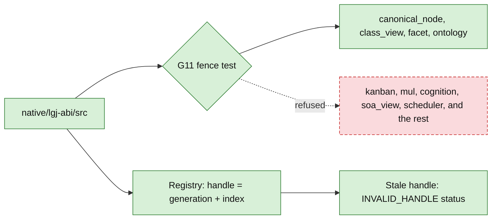
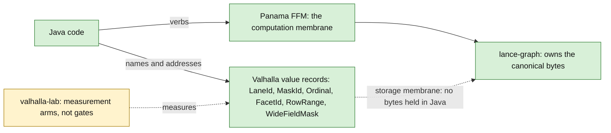
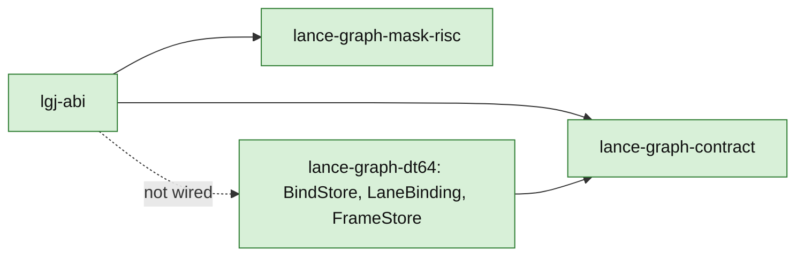

# 10 — lance-graph-java crosswalk

`lance-graph-java` (LGJ) is a separate repo. It puts a Java facade over lance-graph through Panama.
This page shows the layers, the one contract fence, and the two membranes.
Paths for that repo are written as `lance-graph-java/...`.

Status classes: green = in code. Yellow = lab. Red dashed = not wired.

## 1. Layers, top to bottom

What the diagram says:

- The facade is plain Java. `View.where` returns a new view and does not cross the membrane. A terminal call such as `count` runs the whole chain in one crossing.
- The FFM layer is internal. `ApiSurfaceTest` checks by reflection that no `java.lang.foreign` or `internal` type appears in a public signature.
- `lgj-abi` is a machine ABI, not a C API. It has no header and no JNI. The compiled library describes itself in a manifest, and Java checks every size and alignment against its own layout constants before the first call.
- `lgj-abi` depends on the contract crate, on `lance-graph-mask-risc` and on `ndarray`. It lowers a plan to one `mask_risc::Program` and keeps no second evaluator.
- All SIMD comes from `ndarray::simd`. Java has no compute backend.

Sources:

- `lance-graph-java/java/src/main/java/com/adaworldapi/lancegraph/View.java:1-42` (lazy view, one crossing per terminal)
- `lance-graph-java/java/src/main/java/com/adaworldapi/lancegraph/Mask.java:36` (`Mask`)
- `lance-graph-java/java/src/main/java/com/adaworldapi/lancegraph/RowStore.java:43` (`RowStore`)
- `lance-graph-java/java/src/main/java/com/adaworldapi/lancegraph/internal/ffm/Downcalls.java:38` (`Linker.nativeLinker()`)
- `lance-graph-java/java/src/test/java/com/adaworldapi/lancegraph/ApiSurfaceTest.java:40,97` (internal prefix check by reflection)
- `lance-graph-java/docs/abi.md:8-58` (no C, manifest instead of a header)
- `lance-graph-java/docs/abi.md:60-84` (the ABI is small and bulk-only; 30 symbols)
- `lance-graph-java/docs/abi.md:420-441` (anti-JNI rule)
- `lance-graph-java/native/lgj-abi/Cargo.toml:30,46,59` (ndarray, contract, mask-risc dependencies)
- `lance-graph-java/native/lgj-abi/src/plan_lower.rs:1-7` (plan lowers to one `mask_risc::Program`)

## 2. Handles and the G11 fence

A handle is an opaque `u64`: a generation in the high half and an index in the low half.
The generation is bumped each time a slot is freed. A stale or fabricated handle returns a status code.
The Java caches of lane and mask addresses are weaker. `Mask.words()` re-checks the epoch on use.
`RowStore`'s cached lanes do not. The ABI document records this as an open issue.

The G11 fence limits what `lgj-abi/src` may import from the contract crate.
Only four modules are allowed: `canonical_node`, `class_view`, `facet` and `ontology`.
The cognitive modules compile unconditionally, so this test is the only barrier.
The test walks `src/` recursively and also rejects aliases and glob imports.
It reads the lists in `CLAUDE.md` and `Cargo.toml` and requires them to equal its own list.

Sources:

- `lance-graph-java/native/lgj-abi/tests/g11_contract_import_fence.rs:1-40` (what the fence closes)
- `lance-graph-java/native/lgj-abi/tests/g11_contract_import_fence.rs:44` (`ALLOWED`)
- `lance-graph-java/native/lgj-abi/tests/g11_contract_import_fence.rs:224-228` (violation message)
- `lance-graph-java/native/lgj-abi/tests/g11_contract_import_fence.rs:268-273` (documented lists must equal `ALLOWED`)
- `lance-graph-java/native/lgj-abi/Cargo.toml:36-46` (fence comment and contract dependency)
- `lance-graph-java/native/lgj-abi/src/class_view_provider.rs:64-66` (the contract imports in use)
- `lance-graph-java/docs/abi.md:245-272` (handle layout and results)
- `lance-graph-java/docs/abi.md:283` (cached descriptors, `Mask` versus `RowStore`)
- `lance-graph-java/native/lgj-abi/src/registry.rs:1-18` (generation-checked registry)

## 3. Two membranes: Panama and Valhalla

Panama carries the verb: operations across the boundary onto lance-graph's bytes.
Valhalla carries the noun: small identity-free values such as `LaneId` and `WideFieldMask`.
Neither owns storage. lance-graph owns the only canonical copy.

The repo's own text calls these two orthogonal guarantees, not one layer.
The Valhalla types are declared `public value record`. The repo pins JDK 28 for them.
JEP 401 is a preview feature, so the build sets the preview flag repo-wide.

Sources:

- `lance-graph-java/CLAUDE.md:22-47` (JDK 28, two membranes, neither owns storage)
- `lance-graph-java/java/src/main/java/com/adaworldapi/lancegraph/LaneId.java:31` (`public value record`)
- `lance-graph-java/java/src/main/java/com/adaworldapi/lancegraph/MaskId.java:23`
- `lance-graph-java/java/src/main/java/com/adaworldapi/lancegraph/Ordinal.java:19`
- `lance-graph-java/java/src/main/java/com/adaworldapi/lancegraph/FacetId.java:21`
- `lance-graph-java/java/src/main/java/com/adaworldapi/lancegraph/RowRange.java:19`
- `lance-graph-java/java/src/main/java/com/adaworldapi/lancegraph/WideFieldMask.java:34`
- `lance-graph-java/CLAUDE.md:415-440` (the surface is meant to look like `sql()`; mask verbs on a public Java signature are a defect)

## 4. The contract types

`WideFieldMask` in Java mirrors `lance_graph_contract::class_view::WideFieldMask`.
It is a one-word, small-tier mirror. The wide promotion is a named seam, not built.

Sources:

- `lance-graph-java/java/src/main/java/com/adaworldapi/lancegraph/WideFieldMask.java:1-12,34` (mirror of the contract currency)
- `crates/lance-graph-contract/src/class_view.rs:70` (`FieldMask`)
- `crates/lance-graph-contract/src/class_view.rs:243` (`WideFieldMask`)
- `crates/lance-graph-contract/src/class_view.rs:1057` (`ClassView` trait)

## 5. DT64 binding and LGJ: not wired

LGJ reaches the contract crate and `lance-graph-mask-risc`. It has no dependency on `lance-graph-dt64`.
A case-insensitive search of the `lance-graph-java` tree finds "dt64" only in one plan document,
`docs/plans/lgj-holographic-object-facade-v1.md`, where it appears in prose. No Cargo edge or source
line links the two. The search is navigation, not proof of absence.

Sources:

- `lance-graph-java/native/lgj-abi/Cargo.toml:30-82` (dependencies: ndarray, contract, mask-risc, optional ogar-class-view, dev-only quack)
- `lance-graph-java/docs/plans/lgj-holographic-object-facade-v1.md:13,18` (the only "DT64" mention found)
- `crates/lance-graph-dt64/Cargo.toml:10` (path dependency on the contract crate)
