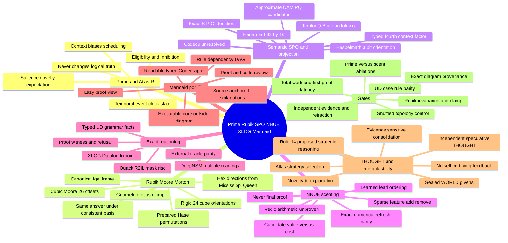
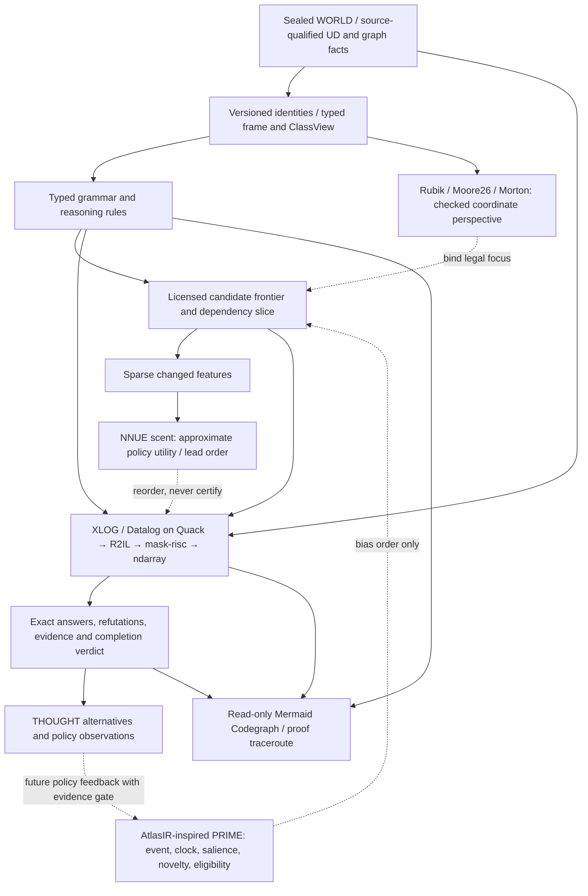
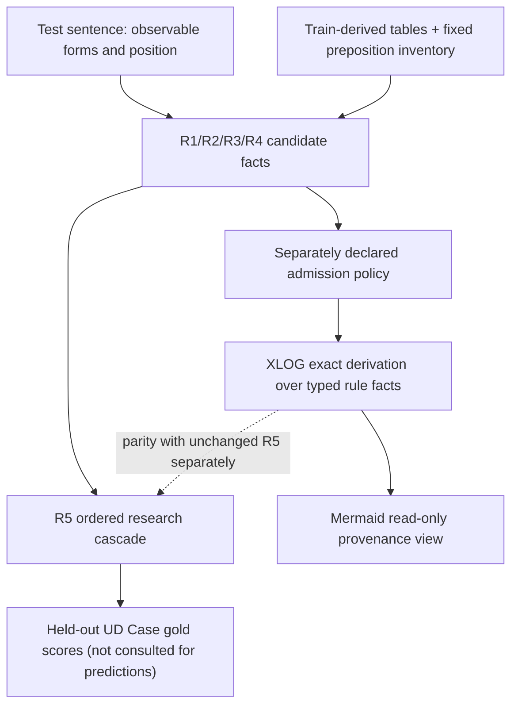
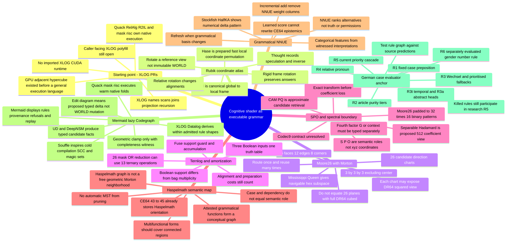
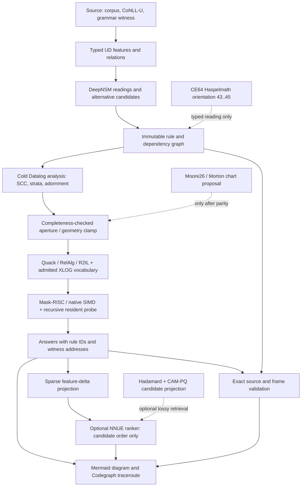
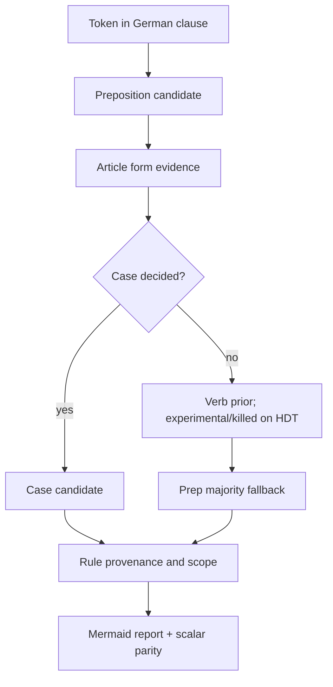

# Cognitive Fabric Convergence: Prime × Rubik/Moore26 × SPO × NNUE × XLOG × Mermaid

**Captured:** 2026-11-01  
**Status:** consolidated, append-friendly RESEARCH SCRATCHPAD. Documentation only: no new implementation, ABI change, merge authorization, performance claim, or learning claim.  
**Repository path:** `docs/research/2026-11-01-prime-rubik-grammar-consolidated.md`  
**Merged from:** (A) `2026-11-01-cognitive-shader-xlog-grammar-mindmap.md` (XLOG → Rubik → Moore26 → Hadamard/CAM-PQ → Haspelmath/UD/NNUE/Mermaid); (B) the other session's illustrated **Prime ↔ Rubik / SPO ↔ NNUE** mindmap and discussion about **AtlasIR, cognitive priming, Role 14, Thought/metaplasticity**, plus the preceding Staunen/Wisdom research conversation.

> **Unified thesis:** The sealed graph is the evidence and relational authority. **AtlasIR-inspired priming** changes which lawful questions are evaluated *first*. **Rubik/Moore/Morton** supplies an optional version-checked coordinate *view*. **NNUE** incrementally ranks candidate investigations. **XLOG/Datalog over Quack/RelAlg/R2IL and mask-risc** produces exact admitted answers. **Mermaid** renders the rule, proof, refusal, and dependency trace. **THOUGHT** holds separate speculative alternatives; **WORLD** is not rewritten by priming, rotation, approximation, or diagrams.

## Source image from the other session

> **Illustration archive note:** The original Prime / Rubik / SPO / NNUE hand-drawn board is preserved in the conversation's downloadable bundle rather than this repository. Its concepts are transcribed here and rendered in the self-contained Mermaid diagrams below; no dangling image path is introduced.

*Caption: The other-session visual has eight regions: (1) Prime/AtlasIR, (2) Rubik/Moore/SPO, (3) NNUE/scenting, (4) exact reasoning, (5) Mermaid polyfill/lazy Codegraph, (6) UD/Haspelmath/grammar, (7) THOUGHT/evidence/metaplasticity, and (8) experiments/gates, with open questions. This document preserves their contributions alongside the earlier technical scratchpad.*

## Reading legend / provenance

- **[SHIPPED]** Existing code or contract examined in prior discussions; only the stated subset, never the whole imagined system.
- **[PROBE]** Bounded lab code or measured fixture; not necessarily production.
- **[PLAN]** Documented research proposal or unrun gate.
- **[IDEA]** Session-generated hypothesis or analogy.
- **[KILLED]** A tested rule failed its declared comparison.
- **[REFUSE]** A non-equivalence or constraint that must block an unsupported inference.
- **[OPEN]** Exact reading or implementation still needs investigation.

**Important origin distinction:** AtlasIR in the cited neural-simulation work is an IR for model definitions, instances and runs, with explicit clocks/events/numerical semantics. **“AtlasIR as cognitive priming/scenting” is an architectural extension being imagined here, not a demonstrated capability of that paper or a shipped Lance-graph behavior.** Similarly, **Role 14** is an idea label, not a verified, registered `ClassId`, bit allocation, or ABI role.

## I. One navigable Mermaid master mindmap

## II. Dependency chain: where each idea belongs

**Reading:** Priming and NNUE affect *order* and *attention*, never the set of admissible final answers under an exhaustive query. Geometric clamping is an optimization only when the query retains every needed dependency or returns a typed incomplete/refusal result. No path from a policy score directly to CE64 certification or source mutation.

## III. Cross-session concept ledger

| Thread | What the other-session mindmap contributes | What the XLOG/grammar scratchpad contributes | Joint status / constraint |
|---|---|---|---|
| **Prime / AtlasIR** | Dynamic event/clock/state, salience, novelty, expectation, inhibition, eligibility traces; priority changes *before* reasoning | Query focus and lazy Codegraph; sound dependency closure | [IDEA] Need defined priming state and update law; AtlasIR physics not Moore physics |
| **Rubik / Hase und Igel** | Perspective switching can expose useful routes and may reduce search work | Canonical global↔local frame, 24 proper cube rotations, invertible charts, exact join equivariance | [IDEA] Rotation of views is not mutation of facts; incompatible frames refuse |
| **Moore26** | 3×3×3 minus center, oriented viewpoint | 6 face + 12 edge + 8 corner offsets; Morton descriptors; DR64²×26 versus logical DR³ | [IDEA] 26 charts are not a lossless arbitrary 64³ relation |
| **Mississippi Queen** | Moving through modular neighborhoods and turns | Six hex directions `(1,-1,0)` permutations embedded in Moore26 edge offsets | [IDEA] Useful turn/traversal fixture, not semantic equivalence |
| **SPO** | Semantic viewpoint as a strategic question | Exact Subject/Predicate/Object roles, 8 causal projection patterns; CE64 fixed bit semantics | [SHIPPED core] Don't rotate semantic role meanings by relabeling coordinates |
| **TernlogQ** | Rapid chained neighborhood masks | Boolean three-input truth tables, OR3 / guarded accumulation; correctness and amortization gates | [SHIPPED primitive / IDEA schedule] Support ≠ count ≠ truth confidence |
| **Haspelmath** | Meaningful semantic-function topology in grammar | CE64 43–45 `Core + 7`, induced connectedness, source-bound markers | [SHIPPED narrow reading] Semantic-map neighbors ≠ Moore/Morton neighbors |
| **UD / DeepNSM** | Grammar as source of constraints for the exact core | Train/test case rules, proper HEAD/DEPREL adapter still missing | [PROBE] Case does not imply Recipient or Direction automatically |
| **XLOG / Datalog / Soufflé** | Exact fixpoint, exhaustive completion, proof witnesses | XLOG native bounded joins/recursion, Soufflé AST→RAM as compiler research and oracle | [PROBE] Existing admitted subset, no second CUDA runtime |
| **NNUE scenting** | Learned ordering, information gain minus cost, candidate anticipation | Stockfish-style sparse add/remove features; EAW-8 docs; optional grammatical ranking | [PROBE reference / IDEA grammar] Rank only; license and independence gates |
| **Mermaid** | Diagram polyfill and self-explaining visual DSL | Read-only view over typed Codegraph, rule dependencies and refusals | [IDEA] Generated diagrams explain execution; editing one proposes a typed delta only |
| **THOUGHT / metaplasticity** | Policy over alternative thoughts, reward/novelty, evidence-sensitive consolidation | WORLD sealed, THOUGHT sparse/versioned alternatives, provenance and retraction | [PLAN] Learned strategy cannot manufacture independent evidence |
| **Role 14** | Perspective-Primed Strategic Reasoning: decide which perspective and search policy to try | Versioned operators, proof gates, speculative branch selection | [IDEA] Research name, not registered role or classid |

### Specific conceptual corrections that must survive consolidation

1. **AtlasIR is not demoted to a mere file format**: its typed definition/instance/run and event/clock semantics make it a scientifically meaningful candidate for a temporal *priming research arm*. But do not claim AtlasIR already implements cognitive learning in Lance-graph.
2. **Not Atlas inside Moore**: Moore handles spatial/local routing; Atlas-style dynamics handle temporal neural/stateful effects; CE64 and typed descriptors may connect the two without conflating their physical models.
3. **“Prime” is not “proof”**: primes set dynamic salience, inhibition and ordering. A completed exact query must return the same answers with or without priming.
4. **“Scent” is not a factual score**: NNUE can rank which derivation to attempt. It cannot assert CE64 F/C, Epi5 Causes, legal grammar, or authorized mutation.
5. **Rubik’s 24 rigid orientations are coordinate automorphisms of the cube**, not automatically automorphisms of *semantic* graph structure. The correct invariance test maps input and result consistently. A selective layer twist is a different, sometimes meaning-changing operation.
6. **Hase und Igel has two interpretations**: the Igel/Hase stable frame and routing metaphor is useful; Floyd’s tortoise/hare cycle finder is not necessarily the fastest runtime for known 24 fixed rotations. Precompute and compare.
7. **Metaplasticity concerns policy/learning dynamics**, not evidence certification. Behavior registration, activation, and changes to synaptic/learned numeric weights are different contracts.
8. **Structural/semantic support is not causal contribution**. XLOG support or path membership is not an independent source root, and causal impact needs an ablation or intervention with proper controls.
9. **NNUE incrementality is numerical**, not a ternlog/Boolean substitution. Candidate feature masks are selectors; `i16` accumulators are numeric, with refresh invalidation on changed feature bases.
10. **No raw CE64 bit reinterpretation**: orientation, causal mask, i4 mantissa, plasticity, witness and EpistemicState5 readings require declared versions and rails. The W 53–58 role is described differently in some older research plans and the current `causal-edge` layout comments; pin and reconcile the producer/consumer reading before any write.

## IV. Role 14, explicitly proposed rather than assumed

**Working name:** `Perspective-Primed Strategic Reasoning` (**Role 14**, [IDEA]).

**Purpose:** schedule a bounded sequence of legal *questions* about a fixed graph by choosing among typed perspectives, incomplete derivations, and speculative THOUGHT branches, using source-qualified priming state and optional NNUE incremental candidate utility.

**Input envelope (conceptual):** source snapshot + frame + query/rule identity + coverage/provenance/permission + current candidate set + AtlasIR-style event/clock state + allowed viewpoints. **Output:** ordered candidates / next investigation / explicit abstention, never a certified fact.

**Hypothetical score:** `utility(candidate) = estimated_information_gain(candidate) - lambda * estimated_total_cost(candidate)`. The estimates require external labels and measured costs; this formula alone establishes no optimality.

**Invariance law:** for a complete answer-bearing query `Q`, `Answer(World,Q,prime) = Answer(World,Q,no_prime)`, except documented query budgets may return incomplete status, never a false complete answer. Prime affects *when* the first useful proof appears, not *what* a fully explored query proves.

**AtlasIR crossing:** encode time and event/clock dependencies explicitly in a candidate research adapter; do not treat `AtlasIR` event streams as semantic-memory truth or as a verified neural state update in this substrate. A temporal policy must replay under the same pinned state and random seeds.

**Staunen/Wisdom motif:** novelty can propose an exploration event; independent evidence and declared laws decide revision or consolidation. The older Staunen 13-layer fabric, D-STAUNEN gates and EAW proposals are separate research programs, not automatically implemented by Role 14. No self-certifying evidence loops.

## V. Concrete grammar execution anchor

**Real file:** [`crates/deepnsm-v2/examples/ud_case_eval.rs`](https://github.com/AdaWorldAPI/lance-graph/blob/main/crates/deepnsm-v2/examples/ud_case_eval.rs) and [PR #1321](https://github.com/AdaWorldAPI/lance-graph/pull/1321).

| Rule | Runtime behavior in the evaluator | Recorded HDT outcome where known | Exact Codegraph consequence |
|---|---|---|---|
| R1 | Fixed-case prepositions | Acc 90.0%, Dat 92.5% PASS; Gen 68.4% vs 70.9% baseline KILLED | Candidate rule IDs + source and training policy |
| R2 | DET/PRON article purity tiers | No single uniform gate claimed | Categorical lookup with confidence *about prediction*, not NARS confidence |
| R3 | Wechsel contraction / article / verb prior / preposition majority | Article 99.7% in reported arm; verb prior 63.0% vs prep majority 63.9% KILLED | Priority/fallback dependencies; killed prior remains visible |
| R3t / R3a | Time-noun and abstract-head conditional tables | Separate research arms | Typed context feature, not hard truth unless admitted |
| R4 | Comma-adjacent relative pronoun | 80.1% vs 63.8% baseline PASS | Clause-role constraints; long-distance attachment outside local window needs real UD graph |
| R5 | First firing rule: contraction > R1 > R3 > R4 > R2 | Combined research cascade | Important: PASS/KILL printed but **not used for runtime admission** |
| R6 | Article × noun gender × number / stem fallback | Evaluated separately | Not included in R5; don't render an imaginary dependency |

**The critical seam:** current example reads CoNLL-U labels but predicts largely from surface windows, capitalization, nearest preceding verb, and train-mined tables. It does **not** currently walk UD `HEAD/DEPREL` in the case prediction path. Build that typed adapter separately, preserving ambiguity and original source identifiers. A dative case does not imply Haspelmath Recipient, and a word-form match is not semantic identity.

**Source-faithful flow for first experiment:**

**Haspelmath bridge:** [`deepnsm-v2::haspelmath`](https://github.com/AdaWorldAPI/lance-graph/blob/main/crates/deepnsm-v2/src/haspelmath.rs) uses eight named semantic functions including `Judicantis`; [`CE64::Orientation`](https://github.com/AdaWorldAPI/lance-graph/blob/main/crates/causal-edge/src/orientation.rs) uses `Core` plus seven. They are *different* eight-element vocabularies, not a byte-for-byte codebook match. The former's continuity probe tests induced connectedness, and its `Incomplete` result must not be recast as failure.

## VI. Logical executor and source of truth

- [XLOG/lance-graph PR #1910](https://github.com/AdaWorldAPI/lance-graph/pull/1910): **inward** XLOG RIR is described in own Quack/RelAlg/R2IL algebra; **outward** preserve XLOG caller-facing API where admitted. Never import CUDA runtime as mandatory substrate.
- [#1911](https://github.com/AdaWorldAPI/lance-graph/pull/1911) and [#1912](https://github.com/AdaWorldAPI/lance-graph/pull/1912): resident relation context and relation delta support in scoped lab work; not a general complete Datalog ABI.
- [#1896](https://github.com/AdaWorldAPI/lance-graph/pull/1896): one linear recursive XLOG closure, support/affected masking and egglog shared-relation reasoning, with explicit refusals.
- [#1914](https://github.com/AdaWorldAPI/lance-graph/pull/1914) and [xlog #6](https://github.com/AdaWorldAPI/xlog/pull/6): bounded resident closure and independent three-way oracle parity in reported fixtures; learning/cognitive abilities are **not** established by recursion parity.
- [D-SAG-6 Codegraph proposal](https://github.com/AdaWorldAPI/lance-graph/blob/main/.claude/plans/d-sag-6-rust-codegraph-math-logic-tracert-v1.md): source identity → mathematics → logic → evidence traceroute; proposal only, not a live generic Rust Codegraph.
- [Soufflé→RAM research plan](https://github.com/AdaWorldAPI/lance-graph/blob/main/.claude/plans/souffle-ram-64-thought-stack-v1.md): learn from compiler techniques, compare independent oracle. Recursive/multiway/negative rules require individual admission. **A Datalog fixpoint is not a THOUGHT slot.**
- [EAW-8 NNUE plan](https://github.com/AdaWorldAPI/lance-graph/blob/main/docs/research/epistemic-awareness/eaw-8-nnue-epistemic-feature-delta-adapter.md): sparse witnessed relation delta → typed numeric features → candidate ranker; docs-only/unrun. `stockfish-rs` provides an independently pinned numerical reference; avoid license-crossing code copies into Apache code.
- **Previous coverage snapshot:** 140/230 XLOG integration rules admitted at the reviewed checkpoint; 90 refused. Not a current universal completion percentage. Specific missing multi-column/filter/projection/behavior shapes remain individually gated.

## VII. Two kinds of geometry and one policy

**Geometry A, physical/read addressing (Rubik/Moore/Morton):**

- 26 cubic Moore offsets = `{-1,0,1}^3` excluding center (6 faces, 12 edges, 8 corners).
- Rigid cube rotation group has 24 elements; 3D Moran/Morton names a coordinate order, not a semantic predicate.
- A stable `Igel` retains the canonical identity/frame; a prepared `Hase` supplies reversible chart permutations.
- Lazy `view.turn/compose/inverse/orbits` is a proposed API; view permutation may still cost SIMD shuffles/gathers.
- 26 conceptual DR64² planes hold 26 × 4096 bits = 13 KiB if dense and independent; one DR64³ Boolean volume is 32 KiB. **DR³ is already logical/factorized**, so this arithmetic is not proof of a physical saving or universal ternary representability.
- Hex navigation uses six permutations of `(1,-1,0)` satisfying `x+y+z=0` (Moore **edge** offsets), a useful modular river/board fixture.

**Geometry B, meaning (SPO, UD, Haspelmath):**

- S/P/O exact role identities, Haspelmath semantic function connectivity, UD dependency paths, CE64 orientation are distinct typed spaces.
- A semantic connected region requires **attested links**, not Morton proximity.
- `P R Pᵀ` coordinate equivariance is meaningful only with compatible identity frames and properly transformed inputs/outputs. Relative relation rotation is a *new candidate thought*, not a free no-op.

**Policy (Prime/NNUE):** salience and learnt utility can pick the next *legal evaluation*, but cannot move source identities, silently omit alternatives, upgrade epistemic state, or change complete answers.

## VIII. Computational hypotheses and bounds

1. **TernlogQ**: for 26 already-aligned Boolean masks, an OR3 reduction can be expressed with 13 ternary operations versus 25 binary ORs. This is a *logical operation-count estimate*, not benchmark evidence. `acc OR (support AND guard)` is another legal Boolean truth table. Alignment, version tests, memory traffic and cold preparation may dominate.
2. **Amortized atlas**: if preparing direction charts costs `C_prepared` and saves per-query `C_plain - C_charted`, only repeated use beyond `N_break_even = C_prepared/(C_plain - C_charted)` can win, and no break-even exists when the denominator is non-positive.
3. **SPO/G × Hadamard**: a proposed numerical feature matrix `X∈R^(32×16)` uses 26 padded directions and 16 binary participation patterns from S,P,O,G/context. `Z = H32 X H16ᵀ`, exactly invertible before truncation if normalized. This is not four unrestricted 64-valued graph axes, and a Hadamard transform does not generally preserve arbitrary semantic-map adjacency.
4. **CAM-PQ**: optional lossy approximate candidate retrieval from that fixed signature, followed by exact source revalidation. Candidate recall/latency require held-out measurement. **codec9 meaning remains OPEN**.
5. **Vedic/Abakus NNUE**: candidate exact sparse integer update or algebraic optimizer, undefined as an admitted kernel. Define arithmetic/overflow and independent parity before making any performance claim.
6. **AtlasIR temporal prime**: explore event-clock state, novelty, inhibition and eligibility traces with reproducible replay; do not equate salience with neural learning or an evidence witness.

## IX. Cross-session falsifiable experiment matrix

### Integrated experiment arms (same exact oracle, same graph)

| Arm | Policy before exact solver | Purpose |
|---|---|---|
| **A0 no priming** | Frozen deterministic cheap heuristic / native rule order | Cost and correctness baseline |
| **A1 scent** | NNUE incremental candidate ordering without Atlas temporal state | Does a learned ranking help? |
| **A2 Atlas prime** | Atlas-style temporal salience/eligibility scheduling without NNUE | Does stateful priming add value? |
| **A3 Atlas + NNUE** | Prime-informed candidate features and sparse incremental ranking | Is there a synergy beyond either alone? |
| **N0 shuffled novelty** | Shuffled novelty/time signals with identical budget | Detect spurious temporal advantage |
| **N1 shuffled topology** | Break priming–geometry correspondence while keeping legal exact input | Detect mere coordinate-label overfitting |
| **N2 frozen best policy** | No learning; fixed best policy selected on development split | Guard against over-crediting expensive adaptation |

**All arms** must preserve exact fully explored answers, preserve ambiguity and independent evidence roots, and refuse incomplete queries rather than silently returning incomplete answers as complete. For bounded queries, record answer recall and explicit `Incomplete` separately.

**Report**: first useful proof latency, first falsifier latency, total all-answers work, wall time p50/p95, compiled vs warm cost, bytes/allocations, rule evaluations, frame conversions, support/retraction correctness, model/version identity, cache invalidations, train/test temporal leakage, source independence, and learned-policy preparation/training cost (separately). The first proof is not enough if complete-answer cost degrades.

### Smallest actionable gate ladder

| Gate | Exact artifact | Decisive falsifier |
|---|---|---|
| **C0: Preserve** | This combined MD + source visual + provenance and status ledger | One original concept silently lost or promoted to shipped |
| **C1: Grammar baseline** | `ud_case_eval` R1–R5 decisions + abstentions as typed derived trace | One different output/priority; test-time gold leaks into prediction |
| **C2: Admitted grammar** | Separate admission policy based on train/held-out evidence, without changing R5 baseline | KILLED R1 Gen or R3 verb prior still contributes to admitted answer |
| **C3: Executable trace** | Narrow Datalog rule + actual proof-dependency Mermaid emission | Removing necessary premise leaves result/proof visually present |
| **C4: Sound focus** | Typed closure of needed dependencies + proper frame completeness | Geometric clamp changes a complete answer or hides unsupported read |
| **C5: Rubik/Moore** | 26 Morton offsets and inverse; 24 rigid rotations; 4 turns restore | Wrong global/local frame, missing direction or non-invariance |
| **C6: Mask fusion** | TernlogQ or native baseline parity + cold and warm amortization | Incorrect support or no win after prep/shuffle charge |
| **C7: Sparse NNUE** | Frozen model-hash/version, feature adds/removes and refresh oracle | Delta != full refresh, or score becomes truth/evidence |
| **C8: Atlas prime** | Deterministic clock/event replay with candidate order receipts | Priming changes full result set or source witnesses |
| **C9: Four-arm policy** | A0/A1/A2/A3 plus N0/N1/N2 controls | Gains vanish under controls, or total work worsens |
| **C10: Metaplasticity** | Independent versioned strategy revision across THOUGHT alternatives | Duplicate roots or feedback self-certify a strategy |
| **C11: Approx spectral** | Fixed 32×16 vector / Hadamard inverse / CAM-PQ held-out retrieval | Invalid inverse, low recall or approximate result promoted to proof |
| **C12: XLOG caller** | Narrow true caller-facing polyfill and exact oracle | CUDA coupling, wrong answer semantics, silent unsupported RIR |

**Practical dependency ordering:** C1 → C2/C3 → C4, then C5/C6 and C7/C8 as *independent* optimization arms → C9, with C10 only after evidence discipline, and C11/C12 as separate fronts. This avoids one large PR concealing which mechanism actually helped.

## X. Open questions preserved from both sessions

1. Is **Role 14** a name for a research strategy, or a future actually registered behavioral role? Do **not** assume an existing role allocation.
2. Can viewpoint changes reduce total work **without** changing answers? What is the break-even reuse count?
3. When does Atlas priming beat simpler fixed rule ordering or a cheap heuristic?
4. Does the **NNUE scent** outperform a frozen policy after counting numerical feature extraction/maintenance?
5. Can **Mermaid become an executable grammar frontend** through a restricted *typed* edit-to-AST converter while keeping graphical syntax non-authoritative? First support read-only rendering.
6. Where is **Soufflé compatibility** helpful: AST→RAM scheduling, independent oracle, or caller-facing format, without importing a runtime?
7. Can an Atlas-style **eligibility/novelty policy** improve exploration without conflating physics, evidence and learned preferences?
8. Does a Moore26 chart improve locality or does it introduce more coordinate conversion than it saves?
9. How should `codec9` be defined and what independent experiment would decide if it belongs in the spectral boundary?
10. Which CE64 field readings need **cross-plan reconciliation** before a producer of learned/grammar state may write them?
11. How do **evidence-root independence, source edition, incomplete coverage, and causal/non-causal support** survive compilation and a diagram view?
12. Does a composite grammar chart need nested proof dependencies rather than arbitrary per-point checks? Prefer real dependency edges and retraction/replay tests.

## XI. Source index (previously checked, not freshly benchmarked in this consolidation)

- [Original Language LEGO grammar-to-query RFC](https://github.com/AdaWorldAPI/lance-graph/blob/main/docs/research/linguistic-lego-grammar-to-query-rfc.md)
- [German grammar rule inventory](https://github.com/AdaWorldAPI/lance-graph/blob/main/.claude/knowledge/german-grammar-rule-inventory.md)
- [UD German Case evaluator](https://github.com/AdaWorldAPI/lance-graph/blob/main/crates/deepnsm-v2/examples/ud_case_eval.rs)
- [UD PP argument evaluator](https://github.com/AdaWorldAPI/lance-graph/blob/main/crates/deepnsm-v2/examples/ud_pp_arg_eval.rs)
- [CE64 Orientation](https://github.com/AdaWorldAPI/lance-graph/blob/main/crates/causal-edge/src/orientation.rs) and [CE64 v2 layout](https://github.com/AdaWorldAPI/lance-graph/blob/main/crates/causal-edge/src/layout.rs)
- [DeepNSM Haspelmath probe](https://github.com/AdaWorldAPI/lance-graph/blob/main/crates/deepnsm-v2/src/haspelmath.rs) and [Quack semantic-map probe](https://github.com/AdaWorldAPI/lance-graph/blob/main/crates/lance-graph-quack/examples/semantic_map_probe.rs)
- [XLOG shared-relation/recursion PR #1896](https://github.com/AdaWorldAPI/lance-graph/pull/1896); [XLOG native Amendment E #1910](https://github.com/AdaWorldAPI/lance-graph/pull/1910); [XLOG resident context #1911](https://github.com/AdaWorldAPI/lance-graph/pull/1911); [Staunen closure #1914](https://github.com/AdaWorldAPI/lance-graph/pull/1914); [XLOG closure parity #6](https://github.com/AdaWorldAPI/xlog/pull/6)
- [D-SAG-6 Codegraph → Mathematics → Logic → Tracert](https://github.com/AdaWorldAPI/lance-graph/blob/main/.claude/plans/d-sag-6-rust-codegraph-math-logic-tracert-v1.md)
- [Soufflé AST→RAM thought-stack plan](https://github.com/AdaWorldAPI/lance-graph/blob/main/.claude/plans/souffle-ram-64-thought-stack-v1.md)
- [NNUE × DR64³ EAW-8 plan, docs-only](https://github.com/AdaWorldAPI/lance-graph/blob/main/docs/research/epistemic-awareness/eaw-8-nnue-epistemic-feature-delta-adapter.md)
- [Stockfish-rs exact incremental HalfKA](https://github.com/AdaWorldAPI/stockfish-rs/blob/main/src/eval/incremental.rs) and [Stockfish-rs QR64 probe plan](https://github.com/AdaWorldAPI/stockfish-rs/blob/main/docs/plans/d-qr64-stockfish-nnue-feature-mask-v1.md)
- [Lance-graph PR #1321, held-out German grammar case probes](https://github.com/AdaWorldAPI/lance-graph/pull/1321)
- [Lance-graph PRs #1885–#1889, Staunen/learning research thread](https://github.com/AdaWorldAPI/lance-graph/pulls?q=is%3Apr+1885+1886+1887+1888+1889) (check exact PR scopes before treating any as implementation evidence)

## XII. Preservation and review policy

Keep corrections as dated addenda. Keep the two distinct functions of the master diagram explicit: **strategy/attention scheduling** and **exact derivation/proof**. Mark a new result as [MEASURED] only with a command, dataset split, commit, oracle, CPU tier, and work/latency trace. Never change the sealed WORLD through a diagram or a speculative strategy. No self-certifying thoughts or repeated evidence counted as independent.

---

# Appendix: Previous XLOG → Rubik → Grammar scratchpad (verbatim archive)

The following is the earlier scratchpad retained verbatim so that no branch of the first session is lost when the new Prime/Atlas/Role14 layer is added. Its hypotheses and measurements remain status-labeled above.

# Scratchpad: Cognitive Shader → Rotational Atlas → Semantic Grammar Codegraph

**Captured:** 2026-11-01  
**Proposed repository destination:** `docs/research/2026-11-01-cognitive-shader-xlog-grammar-mindmap.md`  
**Status:** Idea preservation / research scratchpad. **Not** an implementation approval, benchmark, new ABI, or PR.  
**Trigger:** Discussion after the XLOG/lance-graph PR review, specifically the user's sequence of ideas from the GPU-adjacent cognitive hypercube through Rubik rotations, Moore26, SPO/Hadamard/CAM-PQ, Haspelmath and Mermaid/UD/XLOG grammar execution.

> **One-sentence thesis:** The existing resident graph substrate could become a *self-explaining cognitive shader*: XLOG/Datalog provides executable relational semantics; lazy, frame-checked coordinate views reduce repeated alignment work; grammatical evidence supplies typed constraints; and a Mermaid view renders the resulting rule-dependency/proof graph without becoming the source of truth.

## Reading legend

- **[EXISTS]** Confirmed existing source code or contract, not necessarily full application integration.
- **[PROBE]** A bounded implementation or test, not a production/general contract.
- **[RESEARCH]** Concept or proposed experiment, not demonstrated.
- **[REFUSE]** Known non-equivalence or safety/ABI boundary.
- **[OPEN]** The user has not decided or the repository does not yet prove it.
- **[KILLED]** An empirical rule lost its preregistered comparison; do not silently promote it.

## 1. Mermaid mindmap: preserve the whole thought, including detours

### Intentional overlap

The arrows between branches are *hypotheses*, not established equivalences. In particular, **Moore spatial direction ≠ Haspelmath semantic adjacency ≠ grammatical `Case=` ≠ CE64 causal projection**. The research challenge is to build typed, checked adapters between those domains, not collapse their identities.

## 2. Sequence of the ideas, in the order they appeared

1. **Reframing XLOG**: The cognitive shader had a GPU-adjacent hypercube geometry but lacked a sufficiently general way to express work. XLOG supplies a compiled relational vocabulary, not a desirable runtime dependency. Native evaluator remains Quack/RelAlg/R2IL → mask-risc → ndarray SIMD. **[EXISTS for admitted shapes / OPEN for generic grammar]**
2. **Rubik-style rotations**: Define invertible permutations on coordinate *views*. Globally consistent relabeling satisfies `A' = P A Pᵀ`; consistent relational composition preserves equivalence after remapping. A layer twist or relative relation rotation is a different, nontrivial transformation. **[RESEARCH]**
3. **Hase und Igel**: Stable **Igel** holds global identities and sealed `LocalMap`/frame; fast **Hase** holds prepared transformations mapping canonical to local chart coordinates. Floyd's tortoise-and-hare can *discover* cycles, but precomputed permutation tables/cycle leaders are cheaper for known fixed rotations. **[RESEARCH; existing local map and two-axis swap are precedent]**
4. **26 × DR64² versus DR64³**: A proposed 26-chart atlas, each chart conceptually exposing 4096 bits. This is 13 KiB of raw dense Boolean payload for 26 independent charts, compared with 32 KiB for a mathematically dense `64³` Boolean cube. **Not** proof of general ternary representability or a real memory saving: current DR³ is already factored/addressed, not a compulsory dense allocation. Better initial design is **one canonical relation plus prepared permutations**. **[RESEARCH]**
5. **Moore26 and Morton**: Upgrade the 26 from arbitrary Rubik cubies to the exact cubic Moore neighborhood `{-1,0,1}³ \ {(0,0,0)}`: six face, twelve edge, eight corner offsets. Morton encodes neighborhood offsets; 24 proper cube orientations permute direction labels. The current Moore tenant is eight-neighbor **2D** and cannot be silently reinterpreted as 26 lanes. **[RESEARCH, existing 2D components]**
6. **Mississippi Queen subgeometry**: Hexagonal neighbor moves can use cube coordinates satisfying `x+y+z=0`, with six offsets that are permutations of `(1,-1,0)`. They are **six edge-offset members** of Moore26, not the six axis-aligned face offsets. Six-way hex rotations and 3D cube rotations are distinct groups. Use this as a navigable, turn-based graph fixture, not a semantic rule. **[RESEARCH]**
7. **TernlogQ chaining**: Three Boolean inputs per truth-table operation enable `accum OR next1 OR next2` or `accum OR (support AND guard)` fusions. A reduction of 26 already-aligned masks needs as few as **13** 3-input OR evaluations rather than 25 binary ORs; that is an **operation-count bound**, not a measured speedup. Account for permutation, gathers, scatter, setup, and SIMD instruction availability. Boolean support is not natural-number bag counting. **[EXISTS for ternlog primitive / RESEARCH for this schedule]**
8. **SPO + codec9 + 4D Hadamard + CAM-PQ**: Treat S/P/O as exact typed relational roles; hypothesize a separate fourth **binary selector** for G/context. The `26→32` padded direction dimension × 16 selection-pattern channels suggests `H32 × X × H16ᵀ` and a 512-coefficient numerical view. Full normalized Hadamard is invertible for real-valued features; truncation/PQ is lossy. An arbitrary semantic graph is **not** diagonalized merely by Walsh-Hadamard. **codec9's exact meaning/ABI remains unresolved**. **[RESEARCH]**
9. **Haspelmath correction and real source connection**: The intended scholar is **Martin Haspelmath** (not Hasselmann). Semantic maps test whether a grammatical marker's attested function set occupies a connected **induced** subgraph. Edges are cross-linguistic proposals, **not** guaranteed metric distances or proof of diachronic causation. CE64 bits 43–45 already define Core/unoriented and seven named dative orientations. **[EXISTS]**
10. **Existing Haspelmath codebook seam**: `causal-edge::Orientation` has `Core + 7`; `deepnsm-v2::haspelmath::DativeFunction` has **8 named functions including Judicantis and no Core**. Their ordinal codes are different contracts; any mapping must be explicit and typed. **[OPEN]**
11. **Grammatical NNUE**: Map observed, admitted grammar candidates into sparse *model* feature IDs. Incrementally update numeric accumulator columns when a candidate changes; refresh on structural scope/model/schema rebinding. Keep CE64 F/C, orientation, inference and EpistemicState5 untouched. Stockfish-rs HalfKA delta update gives a tested numerical pattern; EAW-8 is an **unrun docs-only** adapter plan. GPL-3.0/Apache-2.0 code-transfer boundary. **[RESEARCH]**
12. **Mermaid-as-polyfill, lazy Codegraph**: Turn typed grammar facts/rules into a source/revision-aware dependency graph and *render* it as Mermaid. The graph computes using Datalog/XLOG and native admitted algebra. Soufflé's AST→RAM, dependency stratification, SCC scheduling, magic sets and rule specialization are cold compiler inspirations, not another hot interpreter. A diagram edit is a proposed validated delta, not direct authority. **[RESEARCH with existing relevant probes]**
13. **`ud_case_eval.rs` is the concrete starting fixture**: It already evaluates German case rules on train/test UD corpora with separate falsifiers, baseline comparisons, priority cascade, abstentions and confusion counts. Preserve this evaluation behavior as an oracle before turning rules into typed facts. It does **not** currently derive predictions by directly traversing test-time `HEAD/DEPREL`. **[EXISTS]**

## 3. End-to-end functional dependency diagram

**Structured dependency chain over goto checks:** every rule result should record `depends_on`, `derived_by`, `source_witness`, `frame`, `read_set`, `refused_for`, and `validated_by` where applicable. This is a rendering of the existing typed semantic facts, never a second parser or independent rule engine. The diagram should remain legible even if the optional numerical branches are absent.

## 4. Exact contracts and red lines

| Boundary | Preserve | Do not silently do |
|---|---|---|
| **WORLD / THOUGHT** | Immutable givens and frame-checked speculative overlays | Mutable ANGLE; rotate canonical identities in place; treat coordinate view as evidence |
| **Frame / local map** | Global identity ↔ local ordinal, digest/version/authorization | AND or join different frame ordinals by coincident u8 values |
| **CE64** | Fixed layout; orientation at bits 43..45; F/C and EpistemicState5 retain their declared meaning | Repack morphology, colexification, syntax valency, or entropy into those bits |
| **Haspelmath** | Induced-subgraph connectedness for sufficiently complete attested marker coverage | Equate case, arbitrary Morton proximity, similarity, semantic contiguity, and causality |
| **3D geometry** | 26 neighbor offsets and checked chart maps | Claim `26×DR² == arbitrary DR³` or 24 cube orientations == 26 neighbors |
| **Ternlog** | Boolean masks and exact truth-table law; check operand convention | Use Boolean OR to count multiplicities; claim measured speedup from op count |
| **Hadamard** | Numerical linear transform over precisely defined features | Claim ordinary transform preserves arbitrary graph adjacency or acts as a Datalog solver |
| **CAM-PQ** | Optional approximate nearest candidate retrieval; exact recheck | Promote approximate similarity into exact relation or certified cause |
| **NNUE** | Sparse categorical feature deltas, model-hash pin and reference refresh | Map grammar scores to NARS F/C; use learned score as hard licensing or source truth |
| **Mermaid** | Read-only render of rule graph, witnesses and refusals | Parse diagram styling as executable semantics or accept unchecked diagram edits |
| **Soufflé** | Independent oracle / source of compile-time techniques | Import mandatory runtime, assume unbounded negation or gather is currently native |
| **XLOG** | Existing compiled RIR vocabulary and consumer compatibility target | Import XLOG CUDA runtime or treat one closure probe as full Datalog completion |

## 5. Concrete German grammar anchor: `ud_case_eval.rs`

**Source:** [`crates/deepnsm-v2/examples/ud_case_eval.rs`](https://github.com/AdaWorldAPI/lance-graph/blob/main/crates/deepnsm-v2/examples/ud_case_eval.rs).  
**Measurement record:** [lance-graph PR #1321](https://github.com/AdaWorldAPI/lance-graph/pull/1321), with `.claude/knowledge/german-grammar-rule-inventory.md`.

| Rule | Description | Fidelity / gate note |
|---|---|---|
| R1 | Fixed Acc/Dat/Gen prepositions; governed NP window | HDT Acc 90.0%, Dat 92.5% [PASS]; Gen 68.4% vs 70.9% baseline [KILLED] |
| R2 | Train-derived DET/PRON case-purity tiers | Categorical evidence; not a universal grammar law |
| R3 | Wechsel: contraction, unambiguous article, `(prep, verb lemma)` prior, prep-majority fallback | Article 99.7% on measured HDT arm; verb prior 63.0% vs 63.9% prep-majority [KILLED] |
| R3t | Temporal heads by train-mined time noun set | Separate gated experiment |
| R3a | Abstract head via derivational suffixes | Separate gated experiment |
| R4 | Relative pronoun near comma; surface-condition train table | HDT 80.1% vs 63.8% form baseline [PASS] |
| R5 | Combined priority: `R3 contraction > R1 > R3 > R4 > R2` | **Research cascade currently still uses killed R1 Gen / R3 verb-prior branches**; PASS/KILL is printed, not enforced admission |
| R6 | Article form × noun gender × number, stem fallback | Reported separately; **not** part of R5 |

**Crucial source detail:** test-time prediction is based on surface forms, local positional windows, capitalization, inferred verb lemma, and train tables. It parses CoNLL-U `Case=` etc. but does not use `HEAD/DEPREL` as an actual graph traversal in `predict`. Therefore a genuine UD dependency Datalog graph is a **next-stage adapter**, not something `ud_case_eval` already implements.

**Minimal example of a derivation trace:**

**No false semantic lift:** `Case=Dat` is not automatically `Recipient`, and `Case=Acc` is not automatically movement/direction. That requires construction, dependency and Haspelmath-function evidence.

## 6. XLOG / native evidence checkpoint

| Source | What was actually reported | What remains unproven |
|---|---|---|
| [lance-graph #1910](https://github.com/AdaWorldAPI/lance-graph/pull/1910) | Amendment E chooses XLOG RIR → own algebra; caller API polyfill outward; no xlog runtime/CUDA dependency | End-to-end caller parity |
| [lance-graph #1911](https://github.com/AdaWorldAPI/lance-graph/pull/1911) | Resident cube, lazy views, 36-join parity, randomized differential tests | General multi-tile or production executor |
| [lance-graph #1913](https://github.com/AdaWorldAPI/lance-graph/pull/1913) | XLOG term built-ins `functor`, `arg`, `=..` explicitly routed to behaviour lens | Execution of term built-ins |
| [lance-graph #1914](https://github.com/AdaWorldAPI/lance-graph/pull/1914) | Resident mask recursion and 400 BFS differentials | Learning, broader recursion shapes |
| [xlog #5](https://github.com/AdaWorldAPI/xlog/pull/5) | Repeated-variable single-relation diagonal support | Diagonal inside input of join |
| [xlog #6](https://github.com/AdaWorldAPI/xlog/pull/6) | Three-way closure parity, BFS versus `Cube::closure` versus XLOG reach; disable tests | General-purpose recurrence performance and full API |
| [lance-graph #1896](https://github.com/AdaWorldAPI/lance-graph/pull/1896) | One linear recursive XLOG closure and egglog reasoning over shared relation | Directed proof for general graph, compiler/MLIR, general recursion |
| [lance-graph #1321](https://github.com/AdaWorldAPI/lance-graph/pull/1321) | German grammar gold evaluation, pass/kill results | Rule-dependency execution and graph provenance |

**Previous integration census:** 140/230 XLOG sample rules admitted and 90 refused. This is a previous fixture count, **not** the completion percentage for all XLOG semantics, and not a freshly rerun census. Behaviour-related refusals are intentional until their own semantics are admitted.

## 7. Minimal falsifiable gates, by dependency not excitement

| Gate | Smallest exact artifact | Falsifier / stop |
|---|---|---|
| **G0: Preserve diagram** | This Markdown mindmap, typed source references, decision ledger | Can no longer distinguish shipped, probe, speculative and killed |
| **G1: Case graph parity** | Test-only typed facts + rule IDs for `ud_case_eval.rs` R1–R5; deterministic Mermaid trace | One prediction/abstention/priority differs from source evaluator; or removing a necessary fact leaves proof node visible |
| **G2: Rule admission** | External verdict policy for R1 Gen, R3 verb prior; preserve unchanged baseline | Killed branch still influences *admitted* variant, or baseline silently changes |
| **G3: UD graph evidence** | Proper head/deprel, morphological case, clause and edition facts with explicit source IDs | Mislabels DAT as Recipient or reads test-time gold; misses long-distance licensed edge without refusing |
| **G4: XLOG/Quack lowering** | One compiled grammar rule + one bounded recursion/closure; exact scalar/Soufflé oracle | Unsupported RIR shape silently reinterpreted, materialized hidden gather, wrong dedup/bag semantics |
| **G5: Lazy clamp** | Scoped rule dependency closure and focus-address witness | Any required external dependency excluded; incorrect negative/unknown answer after clamp |
| **G6: Moore26 atlas** | 26 offsets, Morton encode/decode, 24 rigid rotations, bounded DR64² views | Non-invertible frame mapping; join semantics change under consistent relabel; 26 channels assume arbitrary DR³ |
| **G7: Ternlog amortization** | Prepared masks, fusion vs native reference, cold/warm cost with reuse break-even | Scalar mismatch or total cost never wins after prep/shuffle charges |
| **G8: Incremental grammar NNUE** | Model schema/hash, sparse change multiset, exact full-refresh parity for integer accumulator | Remove/add error fails parity; learning score changes evidence or authorization |
| **G9: Hadamard/CAM-PQ** | 32×16 feature contract, exact unquantized inverse, held-out approximate retrieval | Inverse error outside tolerance; candidate recall below baseline; similarity promoted to truth |
| **G10: Caller interface** | One real XLOG caller sequence through narrow polyfill adapter | Requires CUDA buffer or caller-specific semantic rewrite; no stable output contract |

**Recommended immediate gate: G1, with G2 a strictly separate decision.** It gives the proposed self-solving Mermaid grammar graph one precise source oracle and one concrete counterexample instead of prematurely implementing a general language engine.

## 8. Decisions still open / questions not to forget

- Does **lazy Codegraph** mean lazy *rule expansion*, lazy *materialization*, lazy *coordinate alignment*, or all three? Keep measured costs separately.
- Does **Rubik rotation** merely change the global/local view (answer-preserving), or deliberately rotate one relation against another (counterfactual candidate)? Different typing and tests.
- Is the **Moore26 atlas** a direction codebook, 26 independent relation planes, or 26 views of *one* canonical plane? Prefer testing descriptors first, never duplicate unmeasured data.
- How are **semantic map edges** sourced and how is incomplete corpus coverage represented? No equivalence between semantic topology and spatial neighborhood.
- Can the **Haspelmath harness `Judicantis`** map into CE64 without loss, when CE64 uses code 0 for Core and has only seven non-Core functions? Requires explicit refusal or separate function-identity plane; do not truncate.
- Can **diagram edit → proposed typed relation** be safe and useful? No direct editing of WORLD, parser/compiler rules or proof state.
- Which **Soufflé** features are reference-only versus admitted native lowering? Negation, bag multiplicity, arbitrary arity and recursive joins remain separate gates.
- Does **codec9** name a precise existing ABI? Unverified. Do not ascribe nine-bit semantics until identified.
- What is **Vedic NNUE** concretely: exact integer multiply/add acceleration, sparse feature index computation, or another orthogonal transform? No performance assumption without algorithm and parity oracle.
- Should the generated Mermaid graph annotate **nested dependency/provenance chains**, rather than point-by-point `goto`-style checks? Proposed yes, but derive it from actual dependencies and record refusals/non-executed branches.

## 9. Relevant existing primary source and plan links

- [Language LEGO grammar-to-query RFC](https://github.com/AdaWorldAPI/lance-graph/blob/main/docs/research/linguistic-lego-grammar-to-query-rfc.md)
- [German grammar rule inventory](https://github.com/AdaWorldAPI/lance-graph/blob/main/.claude/knowledge/german-grammar-rule-inventory.md)
- [German UD case evaluation](https://github.com/AdaWorldAPI/lance-graph/blob/main/crates/deepnsm-v2/examples/ud_case_eval.rs)
- [German UD PP argument evaluation](https://github.com/AdaWorldAPI/lance-graph/blob/main/crates/deepnsm-v2/examples/ud_pp_arg_eval.rs)
- [DeepNSM-v2 Haspelmath harness](https://github.com/AdaWorldAPI/lance-graph/blob/main/crates/deepnsm-v2/src/haspelmath.rs)
- [Quack Haspelmath semantic-map probe](https://github.com/AdaWorldAPI/lance-graph/blob/main/crates/lance-graph-quack/examples/semantic_map_probe.rs)
- [CE64 dative orientation codebook](https://github.com/AdaWorldAPI/lance-graph/blob/main/crates/causal-edge/src/orientation.rs)
- [CE64 locked field layout](https://github.com/AdaWorldAPI/lance-graph/blob/main/crates/causal-edge/src/layout.rs)
- [D-SAG-6 Codegraph → Math → Logic → Tracert proposal](https://github.com/AdaWorldAPI/lance-graph/blob/main/.claude/plans/d-sag-6-rust-codegraph-math-logic-tracert-v1.md)
- [D-XLOG-NATIVE plan, Amendment E](https://github.com/AdaWorldAPI/lance-graph/blob/main/.claude/plans/d-xlog-native-v1.md)
- [Soufflé AST→RAM thought stack proposal](https://github.com/AdaWorldAPI/lance-graph/blob/main/.claude/plans/souffle-ram-64-thought-stack-v1.md)
- [EAW-8 sparse NNUE feature-delta research plan](https://github.com/AdaWorldAPI/lance-graph/blob/main/docs/research/epistemic-awareness/eaw-8-nnue-epistemic-feature-delta-adapter.md)
- [Stockfish-rs incrementally refreshed HalfKA](https://github.com/AdaWorldAPI/stockfish-rs/blob/main/src/eval/incremental.rs)
- [Mermaid official mindmap syntax](https://mermaid.ai/open-source/syntax/mindmap.html)

---

**Preservation rule:** Future edits should be append-only hypotheses or explicit corrections with source, date and gate. Do not turn an untested adjacency analogy into a register ABI or turn an accepted XLOG parity fixture into claimed general language understanding. Keep the dream and its falsifiers side by side.