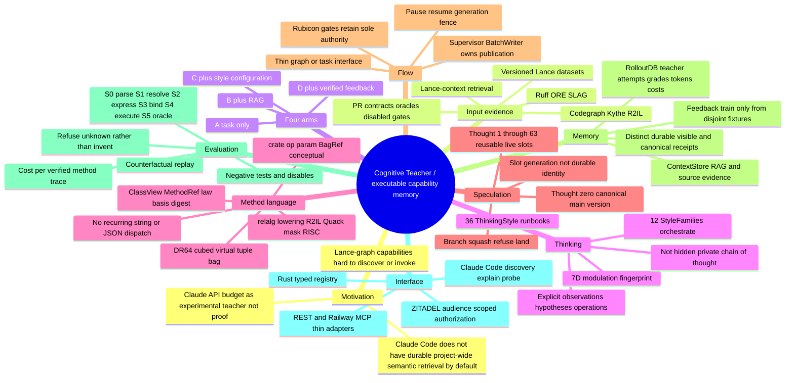

# Cognitive Teacher × Lance-graph — scratchpad / mindmap (2026-11-14)

**Status: PROPOSED · DOCS ONLY · NOT A PRODUCTION CONTRACT.** This preserves the idea before it disperses. It is not a new engine, a new execution IR, a production ThoughtGit land, or a proof that Claude's reasoning is exposed. [Detailed protocol](cognitive-teacher-experiment-v1.md) · [ABI and seam contracts](cognitive-method-bag-abi-v1.md).

## The idea in one sentence

Spend otherwise-unused Claude API experiment budget to get *explicit constructed reasoning plans* over real retrieved evidence, compare those plans against typed/allowed Lance-graph methods and independent oracles, then store every mapping success, refusal, mismatch, and style/feedback outcome for subsequent attempts. Make Lance-graph *intelligible and callable*, not another chatty RAG database.

## Mindmap



## The intuition: translate once, run as a method

External LLM input/output is textual/JSON (unavoidable at model/network boundary). A **cold construction** stage validates observations, references, symbolic operation requests and source evidence. Resolver binds a frozen *method signature* and a *version-qualified virtual bag*. The inner system executes through the existing algebra, not by reparsing textual instructions at every step:

```text
Claude / Rig
  -> structured proposed observation + method plan
  -> capability registry + Codegraph / ORE / SLAG source witnesses
  -> cold compile / bind / refuse
  -> MethodRef + ParamRef + DRBagRef + BasisWitness + LawWitness
  -> ClassView / relalg (where admitted) / R2IL / Quack / mask-RISC
  -> typed OutcomeRef + evidence + independent oracle
  -> RolloutDB trajectory + ContextStore discoverable summary
  -> next Claude attempt (feedback from disjoint prior fixtures)
```

The proposed ergonomic notation `crate::{op}::{param}::{DR{bag reference}}` is a **conceptual locator**, NOT currently Rust path syntax, a verified stable ABI, or a direct executable instruction. Do not conflate `DR64³` (spatial field/geometry), virtual tuple-bag relation/basis, and 3D physical CFD semantics. A virtual bag needs declared shape, owners, addressing, version and admissible lane operations. A 3D spatial neighbourhood or Moore26 read requires independent geometry/oracle gates.

## Roles (one authority each)

| Area | Owner / seam | Must NOT become |
| --- | --- | --- |
| LLM adapter | Rig / Claude API at cold boundary | runtime evaluator |
| Retrieval | lance-context ContextStore | source of execution authority |
| Orchestration | proposed lance-graph-flow thin task driver; ref rs-graph-llm | second scheduler, session DB or executor |
| Canonical methods | Codegraph/ClassView, method/parameter registry, R2IL | text string dispatch each step |
| Virtual bags | DT64 / DR64 basis and owned masks / leases | copied JSON rows, dangling handles |
| Relational semantics | lance-graph-relalg / Quack / mask-RISC with admission | invented gather, cross-table access or SQL semantics |
| Rubicon | kanban.rs / revision / MUL / supervisor | model-generated commit authority |
| Speculation | thought-git-probe lab slot budget | separate durable main or 64-total-thought limit |
| Publication | existing supervisor/cycle driver / BatchWriter | RolloutDB add == canonical Lance version |
| Feedback | RolloutDB, linked outcome/evidence, token cost | oracle or trainer by itself |
| Interface | REST / MCP thin gateways, scoped readonly | raw arbitrary SQL/shell/write access |

## Status discipline

**Confirmed source anchors**:
- `crates/lance-graph-contract/src/style_family.rs`: 12 families and 12↔36 mapping; `thinking.rs`: 36 runbooks + 7D modulation.
- `crates/lance-graph-contract/src/kanban.rs`: legal phase transitions; separate revision and admission.
- `crates/thought-git-probe/src/slots.rs`: slot 0, 1..63, generation, squash/eviction; `thought-git-probe/src/lib.rs` says production land/persistence absent.
- `crates/lance-graph-relalg`, `crates/lance-graph-quack`, `crates/lance-graph-mask-risc`, `crates/lance-graph-r2il` exist (not blanket proof of generic execution).
- Existing `.claude/plans/d-lfa-lance-graph-flow-rubicon-assimilation-v1.md` explicitly says proposed `lance-graph-flow` crate not landed, thin driver only and no competing evaluator. `.claude/plans/d-rft-relalg-thought-git-frontier-v1.md` covers a related frontier. Check their latest exact status before implementation.
- `lance-format/lance-context` RolloutStore: Arrow + MemWAL; `add` durable before visible and returns base version **not an append receipt**; generic stored RL records with strings/JSON at API boundary.
- `lance-context/examples/mcp-claude-code` exists as example, not proven in this integration.

**Proposed, not verified**: a typed direct-RecordBatch Rubicon adapter; round-trip replay of real main; DR64³ spatial integration; Railway MCP deployment; accessible canonical capability registry; actual Claude API credit availability; production closure of F000 scope / method ABI.

## Open design questions to preserve

1. Does `crate::{op}::{param}::{BagRef}` resolve by ClassId/MethodOrdinal, positional F### word, MethodRef, or a composed law-qualified handle? Freeze one canonical contract after source census.
2. What is the durable bag identity: Lance dataset URI/hash + version + owner generation + schema/basis digest + focus + row-order witness? Which pieces can be reconstructed?
3. Which DR64³ objects are spatial neighbourhood bags vs ordinary relational bags, with distinct oracles?
4. Can a generic `RecordBatch` path safely reuse lance-context `StorageBase` without forking the store?
5. How do ThoughtGit squash receipts reference causal parent steps after slot recycling? Do NOT persist a slot index as identity.
6. Can MCP tools return executable capabilities with explicit evidence and refusals instead of guessing methods?
7. Which oracle supports each claim, and what negative test actually fails if the assumption is broken?

## Immediate acceptance target

One pinned fixture travels from Claude structured plan through a **real admitted method or a correct refusal**, independent oracle, durable RolloutDB record, retrieval into a subsequent prompt and stable replay of the decision evidence after teardown. No production Lance write, no fake DR64³ capability, no autonomous landing. Preserve counts, timestamps and tokens for audit.

**Next docs**: [Experiment v1](cognitive-teacher-experiment-v1.md) and [ABI seam map v1](cognitive-method-bag-abi-v1.md).
