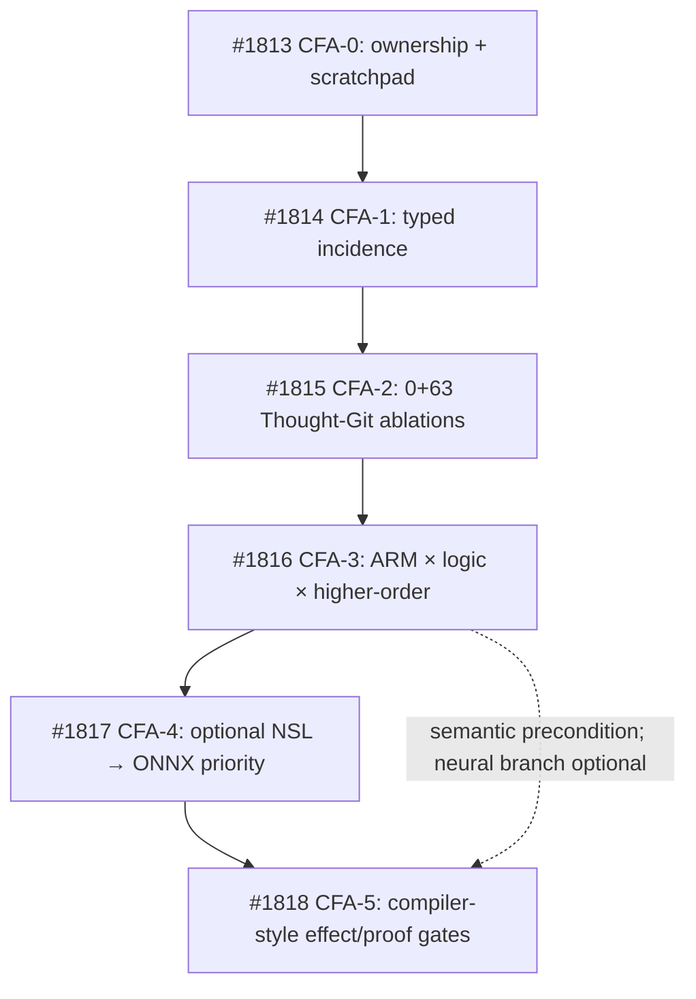

# D-CFA stacked draft PR receipts (2026-10-27)

**All links below are documentation-only DRAFT PRs; these are research preregistrations, NOT merged features, tested gates or implementation authority.** PR base order is the technical review chain. Dependencies between ideas can be less strict (e.g., NSL is optional for compiler analysis).

| Stage | PR | Unique document | Scope |
|---|---|---|---|
| CFA-0 | [#1813](https://github.com/AdaWorldAPI/lance-graph/pull/1813) | [README](README.md), [thought scratchpad](thought-dependency-scratchpad.md) | SoC map and falsifier seeds |
| CFA-1 | [#1814](https://github.com/AdaWorldAPI/lance-graph/pull/1814) | [typed incidence](cfa-1-typed-incidence.md) | no hallucinated guard/method ownership |
| CFA-2 | [#1815](https://github.com/AdaWorldAPI/lance-graph/pull/1815) | [ablation and replay](cfa-2-ablation-replay.md) | single/pairwise replay; protected intermediates |
| CFA-3 | [#1816](https://github.com/AdaWorldAPI/lance-graph/pull/1816) | [ARM and logic](cfa-3-arm-logic.md) | association vs counterfactual dependency |
| CFA-4 | [#1817](https://github.com/AdaWorldAPI/lance-graph/pull/1817) | [NSL/ONNX](cfa-4-nsl-onnx.md) | optional candidate ranking |
| CFA-5 | [#1818](https://github.com/AdaWorldAPI/lance-graph/pull/1818) | [compiler analysis](cfa-5-compiler-analysis.md) | effect-safe cold law admission |

## Reading / refinement order for next round
1. Inspect the [scratchpad](thought-dependency-scratchpad.md): correct the **thought-dependency DAG** before designing physical register shape.
2. Decide exact fixture/source authority. Prefer small independent deterministic specimen plus real multi-emitter source counterexample.
3. Specify which measurements carry enough state to distinguish `prevents`, `requires`, redundancy and conjunction.
4. Define a *single independent oracle* for each disputed inference and one disabling mutation to turn its target test red.
5. Attach negative/UNKNOWN evidence and source roots before any replay squash.
6. Decide whether NSL actually earns its cold training amortization and should remain in the dependency graph.
7. Only then scope one separately approved **test-only** PR.

**No shared boards modified; EXO-50 is an append-only coordination inbox, not a task/authorization gate.**
