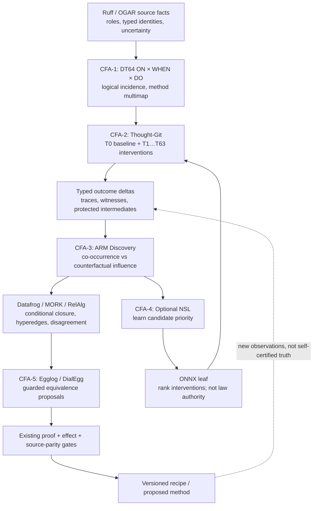

# D-CFA thought dependency scratchpad — first-round breadcrumbs

**Status: evolving research notes, not normative ABI.** Append discoveries here on a future pass; do not treat proposed edges as implemented capabilities. The diagram is a *dependency of research claims*, not a runtime call graph.

## Breadcrumb keys
- **B0 source:** factual role bits in `AdaWorldAPI/ruff/crates/ruff_spo_triplet/src/role.rs` (READS, DERIVES, EFFECTS, CONSTRAINS, REQUIRES, AUTHORIZES, ENABLES, TRIGGERS). OGAR Trigger/Applicability/Capability facets are not a source of populated guards without deployed config.
- **B1 binding:** DT64-Q0 is typed witness/binding and a borrowed input seam, not the new S1 ON/WHEN/DO cube. Coordinate equality without identity witness is not source equality.
- **B2 thought:** `0` is sealed; `1..=63` are speculative slots, **not** the 64 DO axis; slot generation/reuse must not become method identity.
- **B3 intervention:** ablate registered *method identities* where cell multiplicity matters, as well as axis cells; distinguish suppressing ON, altering WHEN, blocking DO. Causal interpretation requires specified intervention semantics.
- **B4 protected history:** #1739 demonstrates that final-state squash can erase intermediate contradictions, divergences, and write multiplicity unless protected witnesses survive.
- **B5 discovery:** ARM co-occurrence/count evidence (#1313/#1359) is separate from Thought-Git ablation evidence; repeated correlated thoughts are not independent evidence.
- **B6 logic:** Datafrog/Ascent can serve cold differential oracles; MORK matches patterns. A closure derived from candidate edges is still candidate-grade.
- **B7 learned prioritization:** NSL may rank which ablations to spend on; graph adjacency need not mean positive similarity (prevention is signed/directional). ONNX prediction != semantic proof.
- **B8 compiler bridge:** MemorySSA offers may-def/use analogies; DialEgg can explore *admitted* MLIR rewrites, but Rust effect/borrow/drop/panic/unsafe constraints cannot be optimized away by observed equivalence.
- **B9 feedback:** revisions and independently admitted rules travel by existing provenance/recipes; no new runtime, no source writes and no unguarded supersession.

## Falsifier seeds for review
| Seed | Small counterexample | Mandatory classification |
|---|---|---|
| K1 | A,B always co-fire but never read/write each other | association only, no required dependency |
| K2 | A,B independently produce same needed value | both single ablations silent, joint ablation changes outcome |
| K3 | C requires A AND B | conjunction hyperedge, not independent A→C or B→C |
| K4 | A disables B only for guard G | conditional prevention, not global inhibition |
| K5 | two methods share a cube coordinate in same base revision | both identities retained; no implicit last-wins |
| K6 | unknown WHEN condition and incomplete authorization | UNKNOWN/REFUSED, not false or true |
| K7 | final state equal but an intermediate side effect/exception differs | cannot squash or certify equivalence |
| K8 | two thoughts replay identical source roots | do not double count independent evidence |
| K9 | same cube ordinals but different source version/codebook | typed refusal on stale binding |
| K10 | learned ONNX predictor ranks wrong on held-out family | no silent deployment or authority |

## Source anchors
- #1605 Thought-Git porcelain/history; #1604 candidates; #1684 replay/commit witness; #1739 protected squash
- #1799 DT64 capstone/Q0; #1797 Thought-Git/edge projections; #1747 DR64³ research/supersession
- #1313 ARM population evidence; #1359 SPOFC do/learn; #1584 learned association measures
- #1760 Rust Codegraph → Mathematics → Logic → Tracert
- LLVM MemorySSA: https://llvm.org/docs/MemorySSA.html
- DialEgg CGO 2025: https://2025.cgo.org/details/cgo-2025-papers/44/DialEgg-Dialect-Agnostic-MLIR-Optimizer-using-Equality-Saturation-with-Egglog
- TensorFlow NSL: https://github.com/tensorflow/neural-structured-learning

## Read-out template (fill after actual probe, NOT NOW)
Fixture + pinned versions | source/coverage | baseline observable | intervention semantics | thought slot/receipt | exact counterfactual diff | independent oracle | competing explanation | grade (observed/model/inferred/proven) | falsifier result | cost | decision/refusal | next breadcrumb.
